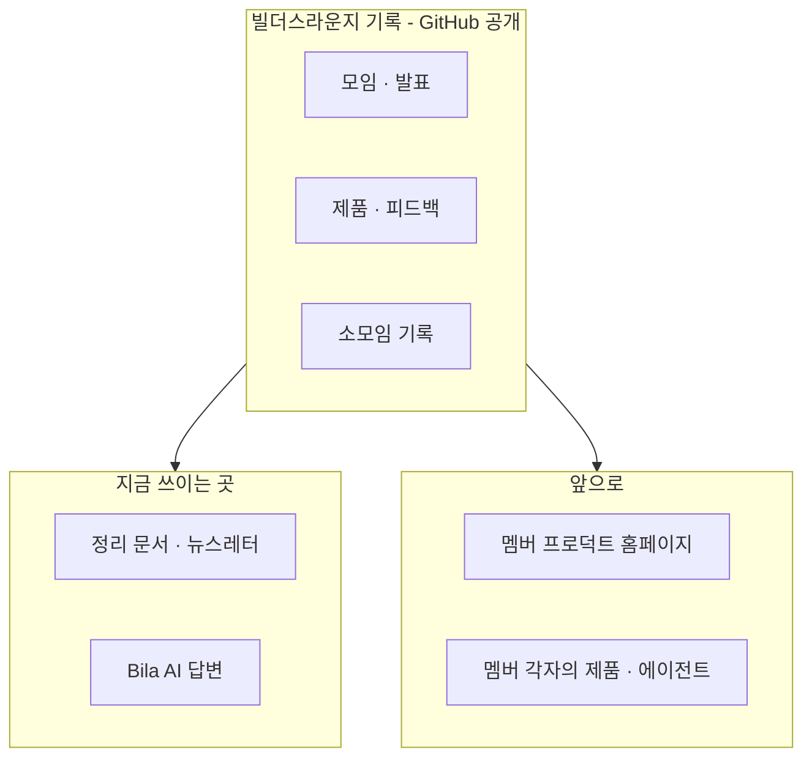
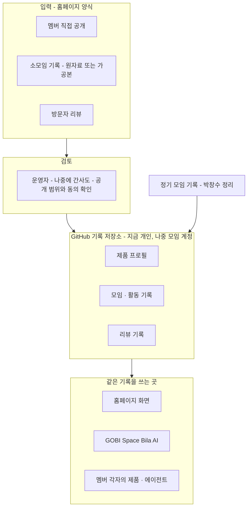

## 이 문서에 대해

> **방송 1차 완료(2026-11-08).** Live #35 와 방송 뒤 이어진 의논에서 1~5단계를 모두 마쳤습니다. 다음은 이 문서로 11월 말 모임 발표 자료와 영상을 만드는 일입니다. 결정 기록 ②칸은 **11월 모임에서 멤버들과 함께 정할 제안**이며 확정이 아닙니다. 「박창수 구술(날짜)」은 박창수가 말한 원문이 개인 기록에 따로 보존되어 있다는 뜻입니다.

Live #35(2026-11-08) 1부에서 박창수와 AI 가 의논하며 채운다. 출발점은 같은 폴더의 「방송용 사전 자료」다. 이 문서는 11월 말 Builders Lounge 모임에서 **박창수가 직접 발표하는 두 번째 세션**(11/7 확정)의 자료와 영상의 원본이 된다. 모임 전체의 운영에 관한 내용은 **모임에 가져갈 제안**이며 확정이 아니다. 방송 화면에 띄우므로 다른 분의 이름 · 발언 원문 · 개인 수익 금액은 적지 않는다.

## 1. 지난 6개월

### 6개월 한 문장

**배우는 사람들의 모임에서 만드는 사람들의 모임으로**

### 발표용 요약

1. **출발** — 스터디가 다시 모였을 때 각자 이미 무언가를 만들고 있었다. 「만든 것을 나누는 빌더 커뮤니티」로 합의하고 5/7 Builders Lounge 로 출범했다.
2. **사람이 넓어졌다** — 2차에는 비개발자가 만든 보드게임 앱, 4차에는 코딩을 모르던 목회자의 앱이 무대에 섰다. IT 엔지니어의 스터디가 AI 로 만들고 싶은 모든 사람의 모임이 됐다.
3. **지역이 넓어졌다** — 10/21 첫 온라인 특강에 Teams 로 66명이 참여했고, 한국에서도 접속했다.
4. **기록이 쌓였다** — 공식 모임 5회와 특강 1회, 영상 9편, 뉴스레터 8호. 이 기록이 Bila AI 의 Context 가 됐다.
5. **남은 숙제** — 서로 만든 것을 써 보고 피드백을 주고받는 일은 부족했다.

### 가장 잘한 것 · 아쉬운 것

| 구분 | 내용 |
|---|---|
| 가장 잘한 것 | **대상을 넓힌 것.** ① 사람: IT 엔지니어 대상 AI Study Group 에서 「AI 로 무엇인가 만들거나 만들고 싶은 모든 사람」으로 — 비개발자 출신 목회자 빌더의 발표가 상징 ② 지역: 시애틀에서 모든 지역으로 — 첫 온라인 특강(Teams 참여 66명)에 한국에서도 접속 |
| 아쉬운 것 | **서로 만든 제품을 써 보고 피드백을 주고받는 것**이 부족했다. 기본 취지 중 하나였지만 발표 중심으로 흘렀다 |

— 박창수 구술(11/8)

## 2. 빌더스라운지의 정체성

### 한 문장 정의

> **AI 로 무언가를 만드는 사람들이 서로의 첫 사용자가 되어 주고, 그 과정을 기록해 사람과 AI 에이전트 누구나 쓸 수 있게 나누는 모임.**
> AI 가 주는 정보는 누구나 얻지만, 사람의 시도와 경험은 만나야 얻습니다.

사전 자료 2절의 후보 A(서로의 첫 사용자) · D(기록을 사람과 AI 에이전트에게 공개) · C(AI 가 줄 수 없는 사람의 경험)를 섞었다. A+D 가 핵심 문장, C 는 보완 줄이다. 쉬운 대외용 표현(후보 B)은 따로 둘지 쟁점에서 다룬다.

### 박창수가 가장 신경 쓰는 특징 — 하나의 기록, 여러 쓰임 (11/7 확정)

빌더스라운지는 과정을 계속 기록한다. 그 기록은 사람뿐 아니라 AI 에이전트를 위한 것이고, GitHub 에 있어 누구나 접근할 수 있는 일종의 데이터 레이크다. 멤버라면 누구나 필요할 때 자기 제품과 AI 에이전트에서 이 기록을 바탕으로 서비스를 만들 수 있고, 의무는 아니다. 데이터는 하나지만 목적에 따라 다양하게 쓰인다. 박창수의 멤버 프로덕트 홈페이지도 그 쓰임 중 하나다. — 박창수 구술(11/7)

#### 발표에서 보여 줄 예 — 지금 · 다음 · 누구나

| 언제 | 누가 · 어디서 | 기록을 어떻게 쓰나 |
|---|---|---|
| **지금 ①** | 운영진(박창수) | 모임 정리 문서와 뉴스레터를 만들 때 |
| **지금 ②** | Builders Lounge 온라인 모임 공간(GOBI Space)의 **Bila AI** | 멤버 질문에 모임 기록으로 답할 때 |
| **다음** | 박창수의 멤버 프로덕트 홈페이지 (한 멤버의 개인 플랜) | 멤버들이 만든 앱을 보여 주고, 써 보게 하고, 피드백을 받을 때 |
| **누구나** | 멤버 각자의 제품 · AI 에이전트 | 필요하면 누구든 이 기록을 가져다 쓴다 — 의무 아님 |

**발표에서 전할 말 (초안)**: 「빌더스라운지의 기록은 운영진만의 것이 아닙니다. 지금은 뉴스레터와 Bila AI 가 이 기록을 쓰고, 저도 한 멤버로서 멤버 프로덕트 홈페이지에 쓰려고 합니다. 여러분의 제품이나 여러분이 만든 AI 에이전트도 필요하면 이 기록을 쓰실 수 있습니다. 의무는 없습니다. 데이터는 하나, 쓰임은 여러분이 정합니다.」 — 박창수 구술(11/8)

### 모임은 정기 모임만이 아니다 — 빌더 소모임 (11/7 확정)

매달 전체 모임 말고도, 누구나 둘 이상이 따로 모여 각자 만드는 AI 프로덕트를 소개하고 AI 를 쓰며 얻은 인사이트를 나눌 수 있다. 그 내용을 기록으로 내 주면 그것도 빌더스라운지 활동이다. 10/25 멤버 둘의 온라인 미팅이 첫 사례다. — 박창수 구술(11/7)

### 정체성 — 모두의 모임

빌더스라운지는 AI 로 무언가를 만드는 사람들이 서로의 첫 사용자가 되어 주고, 그 과정을 기록해 사람과 AI 에이전트 누구나 쓸 수 있게 나누는 모임이다. 여기서 빌더는 앱 개발자만이 아니라 AI 로 워크플로우 · 글 · 콘텐츠를 만드는 모든 사람이며, AI 가 어려운 기술을 대신해 아이디어가 곧바로 프로덕트가 되는 지금은 크리에이터와도 닮아 있다. 매달 정기 모임만이 아니라 누구나 둘 이상 모여 만든 것과 인사이트를 나누고 기록을 내 주면 그것도 빌더스라운지 활동이다. 모임의 크기가 아니라 **만든 것을 나누고 기록하는가**가 기준이다. 그렇게 쌓인 기록은 GitHub 에 공개된 하나의 데이터 레이크로 모두의 것이고, 지금은 온라인 모임도 기록도 누구에게나 열려 있다. AI 가 주는 정보는 누구나 얻지만, 사람의 시도와 경험은 만나야 얻는다.

### 그 위에서 멤버가 할 수 있는 것

멤버가 할 수 있는 가장 기본적인 일은 **자기가 AI 로 만든 것을 발표하고 공유하는 것**이다. 정기 모임이나 소모임에서 만든 것을 보여 준다. 그리고 **다른 멤버가 AI 로 만든 제품을 써 보고 피드백을 줄 수 있다** — 서로의 첫 사용자가 되는 일이다. 그 위에서 멤버는 모임의 광장과 기록을 필요할 때 자기 일에 쓸 수 있다. 공개 기록을 자기 제품이나 AI 에이전트에 가져다 쓸 수도 있다 — 의무는 아니다. 내가 만든 제품은 협업으로 더 나아지거나 다른 멤버의 아이디어가 되어 다른 방식으로 쓰이며 더 풍부해진다. 다음 단계로는 기록을 바탕으로 시너지가 날 멤버를 서로 연결하고, 이슈가 생긴 멤버에게 도울 멤버나 해법을 찾아 주는 **매칭**을 제안한다. 박창수의 멤버 프로덕트 홈페이지도 이런 쓰임 중 하나이며, 한 멤버의 개인 플랜이다.

**기록 활용의 원칙 (11/8 박창수)**: 기록을 누구나 쓰게 하는 취지는 **쓰는 멤버의 필요**에 따라 기록을 활용하는 것이다. 빌더스라운지나 운영자의 필요를 멤버에게 구현하라고 하는 것이 아니다. 멤버 누구나 기록을 특정 목적에 쓰는 방법을 제안할 수 있고, 만드는 데 도움이 필요하면 공개적으로 요청해 서로 맞는 멤버끼리 협업한다. 매칭도 같은 원칙이다 — 운영자가 추구하는 일이므로 함께할 멤버가 있으면 같이 하고, 없으면 운영자의 개인 플랜에서 만든다.

### 쟁점별 박창수의 제안

| 쟁점 | 제안 | 결정 기록 칸 |
|---|---|---|
| 빌더 vs 크리에이터 | 「빌더」 이름을 유지하고, 빌더는 앱만이 아니라 워크플로우 · 글 · 콘텐츠를 AI 로 만드는 모든 사람으로 정의한다. 밖에서는 「한인 AI 활용 모임」처럼 쉬운 말을 함께 쓴다. **덧붙일 인사이트**: AI 가 어려운 기술을 대신하면서 아이디어가 곧바로 프로덕트가 된다. 예전에 앱 만들기를 「개발」이라 불렀다면, 지금은 빌더와 크리에이터가 서로 닮아졌다 — 모임 대화에서 나온 인사이트 — 박창수 구술(11/8) | ② |
| 무엇이 자산인가 | **광장 → 기록 → AI 로 하는 일**의 세 층. ① 지금: 멤버가 만들고 보여 줄 광장(무대)을 꾸준히 유지한다 — 광장에서 기록이 쌓인다 ② 다음: 그 기록으로 AI 에이전트가 할 수 있는 일 — **매칭**(시너지가 날 멤버끼리, 이슈가 생긴 멤버에게 도와줄 멤버나 그 해법을 연결)과 **멤버가 자기 제품 · 에이전트에서 기록 활용**. 다른 쓰임도 더 생길 수 있다. **표현**: 「앱은 복제가 쉽다」 대신 「내가 만든 제품이 협업으로 더 나은 제품이 되거나, 다른 멤버에게 아이디어 · 인사이트가 되어 같은 기능이 다른 방식으로 쓰이면서 내 아이디어가 더 풍부해진다」 — 박창수 구술(11/8) | ① 입장 · ② 매칭 방식 |
| 수익 방향 | **멤버들 사이의 활동이 먼저, 그리고 멤버들의 비즈니스에 도움이 되는 방향.** 모임은 무대와 지속에 필요한 기본 운영비에 집중하고, 사업 성과는 멤버 각자가 만든다. 대부분의 멤버는 자기 비즈니스에 AI 를 쓰고 싶어 하므로, 모임 안에서 그 일에 도움이 되도록 모임을 만들어 간다 — 필요한 멤버가 공개 요청하고 맞는 멤버끼리 협업하는 방식. 「모임 밖의 소상공인을 돕는다」가 아니라 **「멤버들의 비즈니스를 돕는다」**로 표현한다 — 박창수 구술(11/8) | ② |
| 문턱 | **지금은 모두 연다, 커지면 문턱을 둔다.** 지금: 온라인 모임 · 공개 기록 · GOBI Space 모임 공간 모두 누구나 쓸 수 있다(모임 공간은 쓰는 법이 쉽지 않고 필요를 못 느껴 가입이 많지 않음). 나중: 사람과 신청자가 많아지면 **제품 발표 · 제품 공유 · 기록 활용**에 문턱을 두고, 확정된 멤버가 제품을 올리고 모이는 공간을 따로 만든다 — 아직 없음, 앞으로 만들 것. 온라인 모임 참여에는 문턱이 없다 — 박창수 구술(11/8) | ② |
| 범위 | **온라인으로 어디서나, 오프라인은 시애틀/벨뷰에서.** 전체 모임은 항상 온라인으로 열려 지역 제한이 없고, 오프라인은 Bellevue City Hall 에서 얼굴을 보며, 빌더 소모임은 어디서든 둘 이상이 연다 | ② |

## 3. 2027 계획

### 2027 주제

> **AI 로 만드는 사람들의 네트워킹, 그 기록이 시너지가 되는 해**
> AI 로 무언가를 만드는 사람들이 만나 네트워킹하고, 그 과정에서 쌓인 기록으로 멤버들이 서로 시너지를 만들어 내는 한 해

2025 「재미로 하는 바이브 코딩」, 2026 「만드는 모임으로」에 이어 2027 은 **연결과 시너지**의 해다. 세 고리는 네트워킹 → 기록 → 시너지다. — 박창수 구술(11/8)

### 운영 제안

| 영역 | 제안 |
|---|---|
| 모임 주기와 형식 | 전체 모임은 항상 온라인으로 열려 있고, 오프라인으로도 모이며, 오프라인 모임에도 온라인 접속 가능(11/7 확정). **오프라인 주기 (옵션, 멤버 의견 듣기)**: 지향은 매달 오프라인 + 온라인. 사정이 생기면 그달은 온라인만. 장소 섭외와 장소 여건에 따른 일정 조정이 부담이라 유동적으로 둔다 — 옵션 A 매달 / 옵션 B 두 달에 한 번(사이 달은 온라인) / 옵션 C 분기에 한 번(나머지 온라인). **오프라인 참여는 사전 신청 → 승인(Accept)된 사람만** — 장소마다 수용 인원이 달라서다. 이 신청 · 승인 과정을 매달 하기는 어렵다는 점도 옵션을 유동적으로 두는 이유다 — 박창수 구술(11/8). **장소**: 기본은 **Bellevue City Hall** — 무료이고, 크기가 다른 회의실이 10여 개라 오프라인 신청 인원이 파악되면 맞는 회의실을 사용 신청한다. **시설도 잘 갖춰져 있다** — 회의실에서 Teams 를 기본으로 쓸 수 있고 카메라와 마이크가 기본으로 설치되어 있어 하이브리드 모임에 맞다. 장소는 주차와 찾아오기 쉬운 위치를 함께 봐야 해서 지금은 여기 말고 적당한 곳이 없다. 무료로 빌려줄 곳이 생기면 같은 기준으로 검토한다 — 박창수 구술(11/8) **하이브리드 진행**: 지금은 박창수 혼자 진행한다. 온라인 미팅 셋업은 박창수, 녹화는 Teams 유료 버전 녹화에 맡긴다. **댓글 · 질문 담당 1~2명**을 두면 좋다 — 채팅에 직접 답하거나 질문을 발표자에게 전달한다. 혼자서도 할 수 있는 일이지만 여러 명이 나눠 맡아도 된다 — 박창수 구술(11/8) |
| 빌더 소모임 — 기록 받는 방법 | **짧은 요약이 아니라 충분한 원자료(raw data)를 받는다.** 나중에 사람과 AI 에이전트가 참고하려면 정보가 충분해야 한다. 녹화 영상 · 전사(Transcript) · 둘 다 · 링크 무엇이든 좋다. 충분한 정보를 유지한 가공본도 되며, 개인정보나 공유하기에 맞지 않는 정보는 멤버가 판단해 고쳐서 낸다. **지금**: 운영진과 공유하면 박창수가 정리해 기록에 넣는다. **나중**: ① 권한을 받아 GitHub 기록 저장소에 직접 올리기 ② 홈페이지를 통해 공유하기(4단계 개인 플랜과 연결) ③ 공유가 많아질 때를 대비해 양식 · 형식과 공유받는 기능 · 프로세스를 따로 마련하거나 개발한다 — 박창수 구술(11/8) |
| 운영 구조와 역할 | **박창수가 당분간 맡을 일**: 방향 · 기록 · 데이터 레이크 관리, 정리 문서 · 뉴스레터 · 칼럼, 영상 편집 · 업로드. **간사가 도와줄 수 있는 일**: 발표자 섭외, 댓글 · 질문 담당, 대외 홍보(SNS · 행사 연결), 장소 신청, 온라인 셋업. 벨뷰 시청 회의실은 누구나 신청할 수 있고, 온라인 셋업은 박창수의 Teams 계정을 공유하면 된다— 계정을 공유하는 대신 회의마다 간사를 **Teams co-organizer**(공동 이끌이)로 지정하는 방법을 쓴다(11/8 박창수 채택). 간사 모임 주기(2주에 한 번 짧게) · 간사 확대는 사전 자료 3절 논점 — 박창수 구술(11/8) |
| 기록과 Bila AI | **상반기에는 기록을 늘리고, 하반기에 매칭을 시험한다.** 지금 Bila AI 는 GOBI Space 에서 모임 기록으로 Q&A 를 한다. 박창수는 GOBI Space 측에서 받은 Bila AI 프롬프트 수정 권한으로 **프롬프트만으로 매칭을 할 수 있는지 리서치**한다. 기능이 더 필요하면 GOBI Space 에 요청하거나(그 회사와 협의 필요) 박창수의 홈페이지에서 구현한다. 매칭은 박창수가 추구하는 일이므로 함께 만들 멤버가 있으면 같이, 없으면 홈페이지에서 한다 — 박창수 구술(11/8) |
| 대외 채널 | **채널을 늘리기보다 역할로 나눈다.** 발견(처음 알게 되는 곳): YouTube · 지역 신문 칼럼 · 소셜(Threads · X · LinkedIn) · 행사 / 소식(꾸준히 받는 곳): 뉴스레터 / 참여(모이는 곳): Teams 모임 · GOBI Space · Slack / 지식(기록이 쌓이는 곳): GitHub 기록 · Bila AI. 지식 층이 GitHub 에 있어 특정 플랫폼 의존을 줄인다 |
| 기본 운영비 (11/7 계획 포함 확정) | 아래 「지속 가능성 — 기본 운영비」 절. 상반기 작은 후원 · 도네이션 + 법인 리서치 → 3분기 법인 결정 |

### 지속 가능성 — 기본 운영비

박창수 개인의 수익 추구와 별개로, 빌더스라운지도 지속 가능하려면 기본 운영비를 마련할 방법을 찾아야 한다. 2027 계획에 포함한다(11/7). — 박창수 구술(11/7)

| 항목 | 내용 |
|---|---|
| 무엇에 드나 | 아래 「기본 운영비 항목」 표 — 박창수 구술(11/8) |
| 먼저 알아볼 방법 | **상반기에 작은 후원 · 도네이션으로 시작하고, 동시에 법인 등록을 리서치한다.** 다과비 정도는 지금 상태에서 후원 · 도네이션을 받아도 될 것 같다. 리서치가 먼저 답할 질문: ① 법인 등록 없이 후원 · 도네이션을 받을 수 있는가 ② 비영리 법인으로 등록하면 무엇이 더 유리한가 ③ 어떤 형태의 비영리 법인이 맞고 무엇을 준비하나(11/5 구술). 나머지 후보(자체 수익 · 유료 뉴스레터 · 공모전 팀 참여)는 리서치에 함께 넣는다. (자료에 없음 — 제안: 법인 없이 기존 비영리 단체의 재정 후원(fiscal sponsorship)을 받는 길도 리서치 질문에 넣는다) — 박창수 구술(11/8) |
| 2027 안의 형태 · 시점 | **상반기에 리서치를 끝내고, 3분기에 법인 등록 여부와 형태를 결정한다.** 하반기에 큰 행사나 홈페이지의 모임 도구 전환처럼 돈이 드는 일이 생기기 전에 받을 그릇을 갖춘다 |

#### 기본 운영비 항목

| 항목 | 지금 | 모임 운영비로 필요할 때 |
|---|---|---|
| 도구 구독 | Teams 유료 버전 월 $5 — 박창수 개인 부담 | 모임 비용으로 옮길 수 있음 |
| 오프라인 다과 · 물품 | 장소는 무료(Bellevue City Hall). 핑거 푸드(피자 · 음료)와 컵 · 냅킨 등 물품이 필요 | 10명 · 20명 기준 예산을 알아봐야 함 |
| 에이전트 토큰 | Bila AI 는 GOBI 시스템이 부담 | 빌더스라운지 차원의 도구(예: 모임 도구로 전환된 뒤의 홈페이지)의 토큰 비용 |
| 서버 · 도메인 | 없음 | 빌더스라운지 차원의 도구에 서버 · 도메인 유지 비용 |
| 영상 | 박창수가 편집해 박창수의 YouTube 채널에 올림 — 별도 비용 없음 | 빌더스라운지 채널을 따로 만들면 편집 등 비용. 멤버 이견이 없으면 지금처럼 박창수 채널에 계속 올린다 |
| 비영리 단체 등록 | 없음 | 모임을 공식화하려 비영리 단체로 등록하면 그 비용 |
| 운영진 활동비 | 없음 | 모임 발전을 위해 마련되면 더 좋음 |

**비용 경계 (11/8 박창수)**: 멤버가 자기 필요로 기록을 써서 에이전트를 만들면, 기록 사용은 무료이고 **자기 시스템의 토큰 비용은 각자 부담**한다. 빌더스라운지 차원에서 필요해 만드는 도구는 **모임 운영비**가 필요하다.

**개인 공간 → 모임 도구 (11/8 박창수)**: 홈페이지는 지금 박창수가 **개인 차원에서 기능 구현을 우선 목적으로** 만든다. 빌더스라운지에서 충분히 쓸 수 있다고 판단되면 모임의 도구로 역할을 바꿀 수 있고, 그때는 공개 서비스가 되므로 토큰 · 서버 · 도메인 비용이 모임 운영비로 필요해진다. 기록 저장소도 같은 수순이다 — GitHub 저장소 이름(`builders-lounge-personal-notes`)처럼 지금은 개인 차원의 기록이고, 필요해지면 빌더스라운지 계정의 GitHub 으로 옮긴다. 지금은 그 단계가 아니다 — 박창수 구술(11/8)

### 분기별 로드맵 초안

| 분기 | 할 일 |
|---|---|
| 1분기 | 정체성 · 2027 주제 · 기록 활용 원칙을 멤버와 공유하고, 간사 역할 분담과 Teams co-organizer 를 정한다. 오프라인 주기 옵션(A · B · C)을 정한다 |
| | 빌더 소모임 원자료를 받기 시작하고, 다과비 수준의 후원 · 도네이션을 받아 본다. 법인 리서치와 Bila AI 프롬프트 매칭 리서치를 시작한다 |
| 2분기 | 기록을 늘린다 — 소모임 기록, 서로 써 보고 남긴 피드백. 박창수는 개인 차원에서 홈페이지 기능을 구현한다 |
| | 법인 리서치를 마치고, (옵션) 여름 큰 행사를 준비한다 |
| 3분기 | 매칭을 시험한다 — Bila AI 프롬프트로, 부족하면 홈페이지에서. 함께 만들 멤버가 있으면 같이 |
| | 법인 등록 여부와 형태를 결정한다. (옵션) 빌더스라운지 이름으로 여름 큰 행사에 참여한다 |
| 4분기 | 기록에서 나온 협업 첫 사례를 모임에서 소개하고, 성공 기준으로 1년을 돌아본다 |
| | 홈페이지의 모임 도구 전환과 기록 저장소의 모임 계정 이전을 검토하고 2028 계획을 세운다 |

**여름 큰 행사는 옵션이다(뺄 수 있음).** 다만 한 번은 빌더스라운지 이름으로 무언가를 해 보고 싶다. 떠오른 아이디어: 시애틀의 큰 행사인 **Seattle Tech Week** 에 멤버가 발표자로 참가하거나 빌더스라운지 자체가 참가한다(아이디어 단계) — 박창수 구술(11/8)

로드맵은 오늘 정한 리듬(상반기 기록 늘리기 → 하반기 매칭 시험, 상반기 리서치 → 3분기 법인 결정)으로 만든 **초안**이다. 모임 운영에 관한 줄은 11월 모임에 가져갈 제안이다.

### 2027 말 성공 기준

2027 주제의 세 고리(네트워킹 → 기록 → 시너지)에 하나씩 맞춘다.

| 고리 | 성공 기준 |
|---|---|
| 네트워킹 | **꾸준함** — 매달 정기 모임이 한 번도 끊기지 않는다(12회) |
| 기록 | **서로의 첫 사용자** — 멤버 제품을 서로 써 보고 피드백한 기록이 쌓인다 |
| 시너지 | **기록에서 협업이 나온다** — 매칭이나 공개 요청으로 멤버끼리 협업한 첫 사례 |

과정 지표: 빌더 소모임 원자료 기록이 들어온다 · 멤버가 모임의 도움으로 자기 비즈니스에 AI 를 적용한 사례. 운영 점검: 후원을 시작하고 3분기에 법인 결정을 마친다.

## 4. 부록 — 박창수 개인 Product 플랜: 멤버 프로덕트 홈페이지

> 빌더스라운지의 공식 활동이 아니다. 한 멤버로서 모임의 리소스를 활용해 만드는 제품이다.

### 목적

| 우선순위 | 목적 | 한 문장 |
|---|---|---|
| 첫째 | **피드백 루프** | 써 보고 피드백을 남기고 개선 과정이 쌓이는 곳 — 1단계의 「아쉬운 것」(서로 써 보고 피드백하기 부족)을 메운다 |
| 함께 | 쇼케이스 | 멤버가 만든 것을 누구나 쉽게 찾아보고 써 보는 창 — 피드백의 앞단 |
| 바탕 | 기록 허브 | 멤버가 직접 제품을 공개하고 소모임 원자료를 올리면 기록이 되고, 기록이 다시 화면에 보이는 양방향 입구 |
| 나중 (하반기) | 매칭 실험장 | Bila AI 프롬프트로 부족할 때 매칭을 구현하는 곳 |

지금은 개인 차원에서 기능 구현이 먼저이고, 빌더스라운지에서 충분히 쓸 수 있게 되면 모임 도구로 전환을 제안한다(3단계 운영비 절).

### 사용자와 하려는 일

| 사용자 | 하려는 일 |
|---|---|
| 멤버(빌더) | 내 제품을 직접 공개하고, 받고 싶은 피드백을 적고, 개선 과정을 남긴다. 다른 멤버 제품을 써 보고 피드백한다. 소모임 기록(원자료, 또는 충분한 정보를 유지한 가공본)을 올린다 |
| 방문자 | 제품을 찾아보고 써 보고 피드백을 남긴다. 모임 영상과 기록을 GitHub 대신 쉽게 본다 (지금은 문턱 없음, 모임이 커지면 확정 멤버 공간을 따로 둔다) |
| 박창수(운영자) | 들어온 공개 내용과 기록을 검토해 기록 저장소에 넣고, 공개 범위를 확인한다 (간사가 도울 수 있음) |
| 에이전트 | Bila AI 와 멤버의 에이전트가 같은 기록을 읽는다. 하반기에는 매칭을 시험한다 |

**소모임 기록을 올리는 방식 (11/8 박창수)**: 원자료를 그대로 올려도 되고, 충분한 정보를 유지하면서 가공해 올려도 된다. 개인정보나 공유하기에 맞지 않는 정보는 멤버가 판단해 고쳐서 올린다.

### 기능

| 기능 | 누구를 위해 | 근거 | 첫 버전 / 나중 |
|---|---|---|---|
| 제품 목록 · 상세 | 방문자 · 멤버 | 5/24 · 6/29 구상 | 첫 버전 |
| 받고 싶은 피드백 칸 | 멤버 | 5/24 | 첫 버전 |
| 리뷰 템플릿(첫인상 · 막힌 곳 · 가치 · 개선 제안) | 방문자 · 멤버 | 5/24, 목적 1순위 | 첫 버전 |
| 멤버 직접 공개(제품 등록 → 기록이 됨) | 멤버 | 11/8 2단계(양방향) | 첫 버전 |
| 공개 기록에서 화면으로 자동 반영 | 운영자 | 11/3 | 첫 버전 |
| 소모임 기록 올리기(원자료 · 가공본 · 링크, 공개 동의) | 멤버 | 11/8 3 · 4단계 | 첫 버전 |
| 모임 · 발표 영상 연결 | 방문자 | 영상 인덱스 | 첫 버전 |
| 검토 대기 목록(간사도 검토 가능) | 운영자 · 간사 | 11/8 역할 분담 | 나중 |
| 개선 기록(Product Journey Log) | 멤버 · 방문자 | 5/24 | 나중 |
| 멤버 프로필(줄 수 있는 도움 / 받고 싶은 도움) | 멤버 | 5/24, 매칭 준비 | 나중 |
| 에이전트용 읽기 경로 | 에이전트 | 11/3 | 나중 |
| 매칭 추천 · 공개 도움 요청 게시판 | 멤버 | 11/8 기록 활용 원칙(게시판은 새 제안) | 하반기 |
| 확정 멤버 공간 | 멤버 | 11/8 쟁점 3(문턱) | 모임이 커지면 |

### 기록이 흐르는 길

**양방향**: 홈페이지에서 들어온 것이 기록이 되고, 기록은 다시 홈페이지와 다른 곳에 보인다. **기술 후보(첫 버전)**: 정적 사이트 — GitHub Markdown 을 그대로 원본으로 쓰고 등록 · 리뷰는 양식으로 받는다. 비용이 거의 들지 않아 개인 차원 개발과 맞다. 확정은 11/9 미팅 뒤.

### 첫 버전 범위

| 단계 | 기능 | 이유 |
|---|---|---|
| **v0.1 (4주)** | 제품 목록 · 상세, 받고 싶은 피드백 칸, 리뷰 템플릿, 공개 기록 자동 반영, 모임 · 발표 영상 연결 | 입력 양식 없이 기존 기록만으로 화면을 만들 수 있고, 피드백 루프가 바로 돈다 |
| **v0.2** | 멤버 직접 공개, 소모임 기록 올리기 | 양식 · 검토 · 공개 동의 처리가 필요하다 |

v0.1 의 첫 제품은 **이미 공개된 발표 영상에 나온 제품 5~8개**로 시작한다 — 공개 범위 걱정이 없다. 잘되면 11월 말 발표에서 첫 화면을 보여 줄 수 있다.

### 11/9 협업 미팅에 가져갈 질문

**홈페이지 (박창수 개인 플랜 — 그 자리에서 답을 들어도 됨)**

1. v0.1 다섯 기능(목적: 피드백 루프)을 상대 회사의 기획 도구로 기획하면 기능명세 · 수용 기준 · 와이어프레임이 어디까지 나오나
2. MCP 로 Claude Code 와 연결할 때 실제 흐름 — 기획서가 바뀌면 구현은 어떻게 따라가나(GitHub 동기화 출시 시점 포함)
3. 마크다운으로 내보낸 기획서를 공개 저장소에 둬도 되나, 무료 한도로 이 규모를 기획할 수 있나

**협업 상대 회사를 더 알기 (11/8 박창수 추가)**

4. 상대 회사의 서비스는 어디까지인가 — 기획(PRD · 기능명세 · 유저플로우 · 와이어프레임)에서 끝나는지, 구현 · 배포 · 운영까지 돕는지
5. 상대 회사가 제안한 커뮤니티 협업은 구체적으로 무엇인지 — **듣기만 하고 약속하지 않는다**(모임 전체의 일)

## 결정 기록

| ① 박창수가 정함 | ② 11월 모임에서 함께 정할 것 (제안) | ③ 박창수 개인 플랜 |
|---|---|---|
| 1단계: 첫 온라인 특강 참여 인원은 Teams 기록 66명으로 쓴다 | | 피드백 부족을 메우려는 홈페이지 구상 → 4단계: 목적 우선순위 = 피드백 루프 첫째, 쇼케이스 함께, 기록 허브 바탕, 매칭 실험장은 하반기. 사용자 4종(멤버 · 방문자 · 운영자 · 에이전트), 첫 버전 기능 7개, 기록 흐름(입력 → 검토 → GitHub → 쓰임), v0.1(5개, 4주) → v0.2(직접 공개 · 소모임 기록) |
| 1단계: 가장 잘한 것 = 대상 확대(사람 · 지역), 아쉬운 것 = 서로 써 보고 피드백 주고받기 부족 | | |
| 1단계: 6개월 한 문장 = 「배우는 사람들의 모임에서 만드는 사람들의 모임으로」 · 발표용 요약 5줄 확정 | | |
| 1단계 사실 확인: 목회자 빌더 발표는 4차, 2차의 Brain Training Board Games 는 비개발자가 만든 제품 | | |
| 2단계: 발표에서 쓸 정체성 문장 = A+D 핵심 문장 + C 보완 줄(안 2) | 모임의 공식 정체성 문장으로 채택할지 | |
| 2단계: 「하나의 기록, 여러 쓰임」은 지금 2곳(문서 · 뉴스레터, Bila AI) · 다음(홈페이지) · 누구나(멤버 제품 · 에이전트)로 보여 준다 | 멤버가 기록을 쓰려면 알아야 할 것(위치 · 형식 · 공개 범위) 안내 방법 | 멤버 프로덕트 홈페이지가 기록을 쓰는 다음 쓰임 |
| 2단계: 발표에서 「빌더와 크리에이터가 닮아졌다」는 인사이트를 함께 소개한다 | 쟁점 1 제안: 「빌더」 유지 + 넓은 정의, 대외용 쉬운 표현 병행 | |
| 2단계 쟁점 2: 자산은 「광장 → 기록 → AI 로 하는 일」. 박창수는 매칭과 멤버의 기록 활용 두 가지를 실현하는 일을 맡는다. 「복제가 쉽다」 대신 「나눌수록 내 아이디어가 풍부해진다」로 말한다 | 매칭을 모임의 다음 단계로 삼을지, 매칭에 필요한 공개 범위 · 동의(매칭은 각자 공개해야 의미 — 사전 자료 3절). 쟁점 3 제안: 지금은 모두 열고, 모임이 커지면 발표 · 제품 공유 · 기록 활용에 문턱 + 확정 멤버 공간 — 언제(어떤 기준에서) 문턱을 둘지 | 멤버가 홈페이지에서 직접 제품을 공개하는 기능 — 입력이 기록이 되고, 기존 기록이 홈페이지에 표시되는 양방향 구조 → 4단계로 미룸 (박창수 구술, 11/8) |
| 3단계: 발표에서 쓸 2027 주제 = 제목 「AI 로 만드는 사람들의 네트워킹, 그 기록이 시너지가 되는 해」 + 풀어 쓴 부제 · 오프라인 기본 장소는 Bellevue City Hall(인원에 맞는 회의실 신청), 오프라인은 사전 신청 · 승인제 | 모임의 2027 공식 주제로 채택할지. 오프라인 주기 옵션 A 매달 / B 두 달에 한 번 / C 분기에 한 번 — 멤버 의견 듣기 (지향은 A, 사정이 생기면 온라인만). 무료로 빌려줄 장소(주차 · 위치 기준)를 아는 멤버가 있는지. 하이브리드 모임의 댓글 · 질문 담당 1~2명 자원. 쟁점 5 범위 제안: 온라인으로 어디서나, 오프라인은 시애틀/벨뷰에서 | |
| 3단계: 소모임 기록은 짧은 양식이 아니라 충분한 원자료(녹화 · 전사 · 링크)로 받는다. 지금은 운영진에게 공유하면 박창수가 정리한다 | 소모임 기록을 GitHub 저장소에 직접 올리는 권한 · 방법, 공유가 많아질 때의 양식 · 형식 · 공유 프로세스. 공개 동의를 어떻게 받을지 | 홈페이지를 통한 소모임 기록 공유 → 4단계 |
| 3단계 역할: 박창수는 당분간 방향 · 기록 · 데이터 레이크, 정리 문서 · 뉴스레터 · 칼럼, 영상 편집 · 업로드를 맡는다 | 간사에게 부탁할 일: 발표자 섭외 · 댓글/질문 · 대외 홍보 · 장소 신청 · 온라인 셋업 — 누가 무엇을 맡을지, 간사 모임 주기(2주에 한 번?) · 간사 확대 | |
| 3단계 Bila AI: 상반기 기록 늘리기 → 하반기 매칭 시험. 박창수가 Bila AI 프롬프트로 매칭 가능성을 리서치한다. 온라인 셋업은 Teams co-organizer 지정으로 | 기록 활용의 원칙(쓰는 멤버의 필요가 먼저, 도움이 필요하면 공개 요청 → 협업) 공유 · 동의. 매칭을 함께 만들 멤버. GOBI Space 에 추가 기능을 요청할지(회사와 협의) | 프롬프트로 부족하면 홈페이지에서 매칭 구현 → 4단계 |
| 3단계 채널: 발견 · 소식 · 참여 · 지식 네 역할로 채널을 정리해 발표한다 | 채널 역할 구분에 동의하는지, 소셜 운영을 도울 간사 | |
| 3단계 운영비: 항목 7가지(구독 · 다과 · 토큰 · 서버/도메인 · 영상 · 비영리 등록 · 활동비)와 비용 경계(멤버 자기 도구는 각자, 모임 도구는 운영비). 영상은 이견이 없으면 박창수 채널에 계속 | 영상을 박창수 채널에 계속 올릴지 별도 채널을 만들지. 개인 공간(홈페이지 · 기록 저장소)을 모임 도구 · 모임 계정으로 옮길 시점과 기준 | 홈페이지는 지금 개인 차원에서 기능 구현이 먼저. 충분해지면 모임 도구로 전환 제안 |
| 3단계 운영비 방법: 박창수가 법인 등록 필요성 리서치를 먼저 한다(법인 없이 후원 가능한지, 법인의 이점, 형태와 준비) | 상반기에 다과비 수준의 후원 · 도네이션을 받아 볼지, 받는 방법과 공개 방식. 리서치 결과를 보고 법인 등록 여부 결정 — 제안 시점: 상반기 리서치, 3분기 결정 | |
| 3단계 수익 방향: 발표에서 「모임 밖 소상공인 돕기」가 아니라 「멤버들의 비즈니스를 돕는 모임」으로 말한다 | 쟁점 4 제안: 멤버 활동이 먼저, 멤버 비즈니스에 AI 를 쓰는 일을 모임 안에서 서로 돕는다(공개 요청 → 협업) | |
| 3단계 성공 기준: 발표에서 세 고리에 맞춘 기준 3개(꾸준함 · 서로의 첫 사용자 · 기록에서 나온 협업)를 제안한다 | 성공 기준 3개와 분기별 로드맵 초안에 동의하는지 | |

## 다음에 할 것

| 할 일 | 내용 | 언제 |
|---|---|---|
| **11/9 협업 미팅** | 4절의 질문 5개. 미팅 준비 문서(같은 폴더, 비공개) 3 · 5 · 7절을 11/8 결정으로 고침. 협업(커뮤니티 구축)은 듣기만 | 11/9(월) 17:00 PT |
| **발표 자료 만들기** | 두 번째 세션 30분 + Q&A 10분. 순서: 6개월(1절) → 정체성 · 하나의 기록 여러 쓰임(2절) → 2027 주제 · 운영 제안 · 로드맵 · 성공 기준(3절) → 11월 모임에서 함께 정할 것(②칸). 홈페이지는 「한 멤버의 개인 플랜」으로 짧게(4절) | 모임 날짜 확정 뒤 (11/9 미팅에서 날짜 확인) |
| **영상 만들기** | 발표 자료 기반, 또는 Live #35 녹화 편집 | 발표 자료 뒤 |
| **11월 모임에서 물을 질문** | 결정 기록 ②칸에서 고른다 — 공식 정체성 · 2027 주제 채택, 오프라인 주기 옵션(A · B · C), 간사 역할 분담과 간사 모임 주기, 댓글 · 질문 담당 자원, 기록 활용 원칙 동의, 매칭을 함께 만들 멤버, 소모임 기록 공유 방법, 문턱을 둘 기준, 후원 · 도네이션 시작, 영상 채널 | 발표 자료에 「함께 정할 것」 슬라이드로 |
| 리서치 | 오프라인 다과(피자 · 음료 · 컵 · 냅킨) 10명 · 20명 기준 예산 | 11월 모임 전 |
| 리서치 | 법인 없이 후원 · 도네이션을 받을 수 있는지, 비영리 법인의 이점 · 형태 · 준비, fiscal sponsorship | 2027 상반기 |
| 리서치 | Bila AI 프롬프트만으로 매칭이 되는지 | 2027 상반기 |
| 홈페이지 v0.1 | 공개 영상 속 제품 5~8개로, 기능 5개 | 4주 (11/9 미팅 뒤 시작) |
| (옵션) | Seattle Tech Week 참가 방법 알아보기 | 2027 상반기 |
