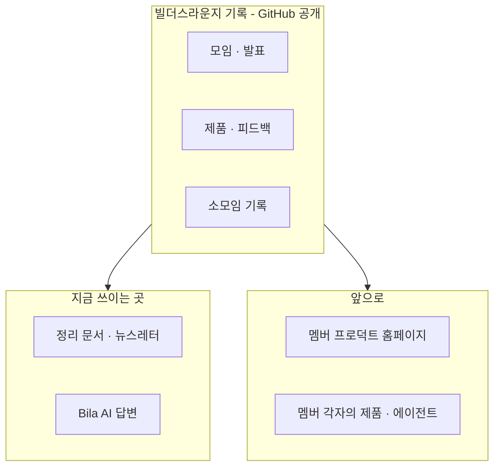

## 이 문서에 대해

> **진행 중인 문서입니다.** Live #35(2026-11-08)에서 1 · 2단계와 3단계 일부까지 정했고, 나머지(3단계 남은 항목 · 4단계 홈페이지 · 5단계 정리)는 이어서 채웁니다. 결정 기록 ②칸은 **11월 모임에서 멤버들과 함께 정할 제안**이며 확정이 아닙니다. 「박창수 구술(날짜)」은 박창수가 말한 원문이 개인 기록에 따로 보존되어 있다는 뜻입니다.

Live #35(2026-11-08) 1부에서 박창수와 AI 가 의논하며 채운다. 출발점은 같은 폴더의 「방송용 사전 자료」다. 이 문서는 11월 말 Builders Lounge 모임에서 **박창수가 직접 발표하는 두 번째 세션**(11/7 확정)의 자료와 영상의 원본이 된다. 모임 전체의 운영에 관한 내용은 **모임에 가져갈 제안**이며 확정이 아니다. 방송 화면에 띄우므로 다른 분의 이름 · 발언 원문 · 개인 수익 금액은 적지 않는다.

## 1. 지난 6개월

### 6개월 한 문장

**배우는 사람들의 모임에서 만드는 사람들의 모임으로**

### 발표용 요약

1. **출발** — 스터디가 다시 모였을 때 각자 이미 무언가를 만들고 있었다. 「만든 것을 나누는 빌더 커뮤니티」로 합의하고 5/7 Builders Lounge 로 출범했다.
2. **사람이 넓어졌다** — 2차에는 비개발자가 만든 보드게임 앱, 4차에는 코딩을 모르던 목회자의 앱이 무대에 섰다. IT 엔지니어의 스터디가 AI 로 만들고 싶은 모든 사람의 모임이 됐다.
3. **지역이 넓어졌다** — 10/21 첫 온라인 특강에 Teams 로 66명이 참여했고, 한국에서도 접속했다.
4. **기록이 쌓였다** — 공식 모임 5회와 특강 1회, 영상 9편, 뉴스레터 8호. 이 기록이 Bila AI 의 Context 가 됐다.
5. **남은 숙제** — 서로 만든 것을 써 보고 피드백을 주고받는 일은 부족했다.

### 가장 잘한 것 · 아쉬운 것

| 구분 | 내용 |
|---|---|
| 가장 잘한 것 | **대상을 넓힌 것.** ① 사람: IT 엔지니어 대상 AI Study Group 에서 「AI 로 무엇인가 만들거나 만들고 싶은 모든 사람」으로 — 비개발자 출신 목회자 빌더의 발표가 상징 ② 지역: 시애틀에서 모든 지역으로 — 첫 온라인 특강(Teams 참여 66명)에 한국에서도 접속 |
| 아쉬운 것 | **서로 만든 제품을 써 보고 피드백을 주고받는 것**이 부족했다. 기본 취지 중 하나였지만 발표 중심으로 흘렀다 |

— 박창수 구술(11/8)

## 2. 빌더스라운지의 정체성

### 한 문장 정의

> **AI 로 무언가를 만드는 사람들이 서로의 첫 사용자가 되어 주고, 그 과정을 기록해 사람과 AI 에이전트 누구나 쓸 수 있게 나누는 모임.**
> AI 가 주는 정보는 누구나 얻지만, 사람의 시도와 경험은 만나야 얻습니다.

사전 자료 2절의 후보 A(서로의 첫 사용자) · D(기록을 사람과 AI 에이전트에게 공개) · C(AI 가 줄 수 없는 사람의 경험)를 섞었다. A+D 가 핵심 문장, C 는 보완 줄이다. 쉬운 대외용 표현(후보 B)은 따로 둘지 쟁점에서 다룬다.

### 박창수가 가장 신경 쓰는 특징 — 하나의 기록, 여러 쓰임 (11/7 확정)

빌더스라운지는 과정을 계속 기록한다. 그 기록은 사람뿐 아니라 AI 에이전트를 위한 것이고, GitHub 에 있어 누구나 접근할 수 있는 일종의 데이터 레이크다. 멤버라면 누구나 필요할 때 자기 제품과 AI 에이전트에서 이 기록을 바탕으로 서비스를 만들 수 있고, 의무는 아니다. 데이터는 하나지만 목적에 따라 다양하게 쓰인다. 박창수의 멤버 프로덕트 홈페이지도 그 쓰임 중 하나다. — 박창수 구술(11/7)

#### 발표에서 보여 줄 예 — 지금 · 다음 · 누구나

| 언제 | 누가 · 어디서 | 기록을 어떻게 쓰나 |
|---|---|---|
| **지금 ①** | 운영진(박창수) | 모임 정리 문서와 뉴스레터를 만들 때 |
| **지금 ②** | Builders Lounge 온라인 모임 공간(GOBI Space)의 **Bila AI** | 멤버 질문에 모임 기록으로 답할 때 |
| **다음** | 박창수의 멤버 프로덕트 홈페이지 (한 멤버의 개인 플랜) | 멤버들이 만든 앱을 보여 주고, 써 보게 하고, 피드백을 받을 때 |
| **누구나** | 멤버 각자의 제품 · AI 에이전트 | 필요하면 누구든 이 기록을 가져다 쓴다 — 의무 아님 |

**발표에서 전할 말 (초안)**: 「빌더스라운지의 기록은 운영진만의 것이 아닙니다. 지금은 뉴스레터와 Bila AI 가 이 기록을 쓰고, 저도 한 멤버로서 멤버 프로덕트 홈페이지에 쓰려고 합니다. 여러분의 제품이나 여러분이 만든 AI 에이전트도 필요하면 이 기록을 쓰실 수 있습니다. 의무는 없습니다. 데이터는 하나, 쓰임은 여러분이 정합니다.」 — 박창수 구술(11/8)

### 모임은 정기 모임만이 아니다 — 빌더 소모임 (11/7 확정)

매달 전체 모임 말고도, 누구나 둘 이상이 따로 모여 각자 만드는 AI 프로덕트를 소개하고 AI 를 쓰며 얻은 인사이트를 나눌 수 있다. 그 내용을 기록으로 내 주면 그것도 빌더스라운지 활동이다. 10/25 멤버 둘의 온라인 미팅이 첫 사례다. — 박창수 구술(11/7)

### 정체성 — 모두의 모임

빌더스라운지는 AI 로 무언가를 만드는 사람들이 서로의 첫 사용자가 되어 주고, 그 과정을 기록해 사람과 AI 에이전트 누구나 쓸 수 있게 나누는 모임이다. 여기서 빌더는 앱 개발자만이 아니라 AI 로 워크플로우 · 글 · 콘텐츠를 만드는 모든 사람이며, AI 가 어려운 기술을 대신해 아이디어가 곧바로 프로덕트가 되는 지금은 크리에이터와도 닮아 있다. 매달 정기 모임만이 아니라 누구나 둘 이상 모여 만든 것과 인사이트를 나누고 기록을 내 주면 그것도 빌더스라운지 활동이다. 모임의 크기가 아니라 **만든 것을 나누고 기록하는가**가 기준이다. 그렇게 쌓인 기록은 GitHub 에 공개된 하나의 데이터 레이크로 모두의 것이고, 지금은 온라인 모임도 기록도 누구에게나 열려 있다. AI 가 주는 정보는 누구나 얻지만, 사람의 시도와 경험은 만나야 얻는다.

### 그 위에서 멤버가 할 수 있는 것

멤버가 할 수 있는 가장 기본적인 일은 **자기가 AI 로 만든 것을 발표하고 공유하는 것**이다. 정기 모임이나 소모임에서 만든 것을 보여 준다. 그리고 **다른 멤버가 AI 로 만든 제품을 써 보고 피드백을 줄 수 있다** — 서로의 첫 사용자가 되는 일이다. 그 위에서 멤버는 모임의 광장과 기록을 필요할 때 자기 일에 쓸 수 있다. 공개 기록을 자기 제품이나 AI 에이전트에 가져다 쓸 수도 있다 — 의무는 아니다. 내가 만든 제품은 협업으로 더 나아지거나 다른 멤버의 아이디어가 되어 다른 방식으로 쓰이며 더 풍부해진다. 다음 단계로는 기록을 바탕으로 시너지가 날 멤버를 서로 연결하고, 이슈가 생긴 멤버에게 도울 멤버나 해법을 찾아 주는 **매칭**을 제안한다. 박창수의 멤버 프로덕트 홈페이지도 이런 쓰임 중 하나이며, 한 멤버의 개인 플랜이다.

### 쟁점별 박창수의 제안

| 쟁점 | 제안 | 결정 기록 칸 |
|---|---|---|
| 빌더 vs 크리에이터 | 「빌더」 이름을 유지하고, 빌더는 앱만이 아니라 워크플로우 · 글 · 콘텐츠를 AI 로 만드는 모든 사람으로 정의한다. 밖에서는 「한인 AI 활용 모임」처럼 쉬운 말을 함께 쓴다. **덧붙일 인사이트**: AI 가 어려운 기술을 대신하면서 아이디어가 곧바로 프로덕트가 된다. 예전에 앱 만들기를 「개발」이라 불렀다면, 지금은 빌더와 크리에이터가 서로 닮아졌다 — 모임 대화에서 나온 인사이트 — 박창수 구술(11/8) | ② |
| 무엇이 자산인가 | **광장 → 기록 → AI 로 하는 일**의 세 층. ① 지금: 멤버가 만들고 보여 줄 광장(무대)을 꾸준히 유지한다 — 광장에서 기록이 쌓인다 ② 다음: 그 기록으로 AI 에이전트가 할 수 있는 일 — **매칭**(시너지가 날 멤버끼리, 이슈가 생긴 멤버에게 도와줄 멤버나 그 해법을 연결)과 **멤버가 자기 제품 · 에이전트에서 기록 활용**. 다른 쓰임도 더 생길 수 있다. **표현**: 「앱은 복제가 쉽다」 대신 「내가 만든 제품이 협업으로 더 나은 제품이 되거나, 다른 멤버에게 아이디어 · 인사이트가 되어 같은 기능이 다른 방식으로 쓰이면서 내 아이디어가 더 풍부해진다」 — 박창수 구술(11/8) | ① 입장 · ② 매칭 방식 |
| 수익 방향 | 3단계 「기본 운영비」에서 함께 다룬다 | |
| 문턱 | **지금은 모두 연다, 커지면 문턱을 둔다.** 지금: 온라인 모임 · 공개 기록 · GOBI Space 모임 공간 모두 누구나 쓸 수 있다(모임 공간은 쓰는 법이 쉽지 않고 필요를 못 느껴 가입이 많지 않음). 나중: 사람과 신청자가 많아지면 **제품 발표 · 제품 공유 · 기록 활용**에 문턱을 두고, 확정된 멤버가 제품을 올리고 모이는 공간을 따로 만든다 — 아직 없음, 앞으로 만들 것. 온라인 모임 참여에는 문턱이 없다 — 박창수 구술(11/8) | ② |
| 범위 | **온라인으로 어디서나, 오프라인은 시애틀/벨뷰에서.** 전체 모임은 항상 온라인으로 열려 지역 제한이 없고, 오프라인은 Bellevue City Hall 에서 얼굴을 보며, 빌더 소모임은 어디서든 둘 이상이 연다 | ② |

## 3. 2027 계획

### 2027 주제

> **AI 로 만드는 사람들의 네트워킹, 그 기록이 시너지가 되는 해**
> AI 로 무언가를 만드는 사람들이 만나 네트워킹하고, 그 과정에서 쌓인 기록으로 멤버들이 서로 시너지를 만들어 내는 한 해

2025 「재미로 하는 바이브 코딩」, 2026 「만드는 모임으로」에 이어 2027 은 **연결과 시너지**의 해다. 세 고리는 네트워킹 → 기록 → 시너지다. — 박창수 구술(11/8)

### 운영 제안

| 영역 | 제안 |
|---|---|
| 모임 주기와 형식 | 전체 모임은 항상 온라인으로 열려 있고, 오프라인으로도 모이며, 오프라인 모임에도 온라인 접속 가능(11/7 확정). **오프라인 주기 (옵션, 멤버 의견 듣기)**: 지향은 매달 오프라인 + 온라인. 사정이 생기면 그달은 온라인만. 장소 섭외와 장소 여건에 따른 일정 조정이 부담이라 유동적으로 둔다 — 옵션 A 매달 / 옵션 B 두 달에 한 번(사이 달은 온라인) / 옵션 C 분기에 한 번(나머지 온라인). **오프라인 참여는 사전 신청 → 승인(Accept)된 사람만** — 장소마다 수용 인원이 달라서다. 이 신청 · 승인 과정을 매달 하기는 어렵다는 점도 옵션을 유동적으로 두는 이유다 — 박창수 구술(11/8). **장소**: 기본은 **Bellevue City Hall** — 무료이고, 크기가 다른 회의실이 10여 개라 오프라인 신청 인원이 파악되면 맞는 회의실을 사용 신청한다. **시설도 잘 갖춰져 있다** — 회의실에서 Teams 를 기본으로 쓸 수 있고 카메라와 마이크가 기본으로 설치되어 있어 하이브리드 모임에 맞다. 장소는 주차와 찾아오기 쉬운 위치를 함께 봐야 해서 지금은 여기 말고 적당한 곳이 없다. 무료로 빌려줄 곳이 생기면 같은 기준으로 검토한다 — 박창수 구술(11/8) **하이브리드 진행**: 지금은 박창수 혼자 진행한다. 온라인 미팅 셋업은 박창수, 녹화는 Teams 유료 버전 녹화에 맡긴다. **댓글 · 질문 담당 1~2명**을 두면 좋다 — 채팅에 직접 답하거나 질문을 발표자에게 전달한다. 혼자서도 할 수 있는 일이지만 여러 명이 나눠 맡아도 된다 — 박창수 구술(11/8) |
| 빌더 소모임 — 기록 받는 방법 | |
| 운영 구조와 역할 | |
| 기록과 Bila AI | |
| 대외 채널 | |
| 기본 운영비 (11/7 계획 포함 확정) | |

### 지속 가능성 — 기본 운영비

박창수 개인의 수익 추구와 별개로, 빌더스라운지도 지속 가능하려면 기본 운영비를 마련할 방법을 찾아야 한다. 2027 계획에 포함한다(11/7). — 박창수 구술(11/7)

| 항목 | 내용 |
|---|---|
| 무엇에 드나 | (방송 중 작성) |
| 먼저 알아볼 방법 | (방송 중 작성) |
| 2027 안의 형태 · 시점 | (방송 중 작성) |

### 분기별 로드맵 초안

| 분기 | 할 일 |
|---|---|
| 1분기 | |
| 2분기 | |
| 3분기 | |
| 4분기 | |

### 2027 말 성공 기준

(방송 중 작성 — 2~3개)

## 4. 부록 — 박창수 개인 Product 플랜: 멤버 프로덕트 홈페이지

> 빌더스라운지의 공식 활동이 아니다. 한 멤버로서 모임의 리소스를 활용해 만드는 제품이다.

### 목적

(방송 중 작성)

### 사용자와 하려는 일

| 사용자 | 하려는 일 |
|---|---|
| 멤버(빌더) | |
| 방문자 | |
| 박창수(운영자) | |
| 에이전트 | |

### 기능

| 기능 | 누구를 위해 | 근거 | 첫 버전 / 나중 |
|---|---|---|---|

### 기록이 흐르는 길

(방송 중 작성 — Mermaid)

### 첫 버전 범위

(방송 중 작성)

### 11/9 협업 미팅에 가져갈 질문

(방송 중 작성)

## 결정 기록

| ① 박창수가 정함 | ② 11월 모임에서 함께 정할 것 (제안) | ③ 박창수 개인 플랜 |
|---|---|---|
| 1단계: 첫 온라인 특강 참여 인원은 Teams 기록 66명으로 쓴다 | | 피드백 부족을 메우려는 홈페이지 구상 → 4단계로 미룸 |
| 1단계: 가장 잘한 것 = 대상 확대(사람 · 지역), 아쉬운 것 = 서로 써 보고 피드백 주고받기 부족 | | |
| 1단계: 6개월 한 문장 = 「배우는 사람들의 모임에서 만드는 사람들의 모임으로」 · 발표용 요약 5줄 확정 | | |
| 1단계 사실 확인: 목회자 빌더 발표는 4차, 2차의 Brain Training Board Games 는 비개발자가 만든 제품 | | |
| 2단계: 발표에서 쓸 정체성 문장 = A+D 핵심 문장 + C 보완 줄(안 2) | 모임의 공식 정체성 문장으로 채택할지 | |
| 2단계: 「하나의 기록, 여러 쓰임」은 지금 2곳(문서 · 뉴스레터, Bila AI) · 다음(홈페이지) · 누구나(멤버 제품 · 에이전트)로 보여 준다 | 멤버가 기록을 쓰려면 알아야 할 것(위치 · 형식 · 공개 범위) 안내 방법 | 멤버 프로덕트 홈페이지가 기록을 쓰는 다음 쓰임 |
| 2단계: 발표에서 「빌더와 크리에이터가 닮아졌다」는 인사이트를 함께 소개한다 | 쟁점 1 제안: 「빌더」 유지 + 넓은 정의, 대외용 쉬운 표현 병행 | |
| 2단계 쟁점 2: 자산은 「광장 → 기록 → AI 로 하는 일」. 박창수는 매칭과 멤버의 기록 활용 두 가지를 실현하는 일을 맡는다. 「복제가 쉽다」 대신 「나눌수록 내 아이디어가 풍부해진다」로 말한다 | 매칭을 모임의 다음 단계로 삼을지, 매칭에 필요한 공개 범위 · 동의(매칭은 각자 공개해야 의미 — 사전 자료 3절). 쟁점 3 제안: 지금은 모두 열고, 모임이 커지면 발표 · 제품 공유 · 기록 활용에 문턱 + 확정 멤버 공간 — 언제(어떤 기준에서) 문턱을 둘지 | 멤버가 홈페이지에서 직접 제품을 공개하는 기능 — 입력이 기록이 되고, 기존 기록이 홈페이지에 표시되는 양방향 구조 → 4단계로 미룸 (박창수 구술, 11/8) |
| 3단계: 발표에서 쓸 2027 주제 = 제목 「AI 로 만드는 사람들의 네트워킹, 그 기록이 시너지가 되는 해」 + 풀어 쓴 부제 · 오프라인 기본 장소는 Bellevue City Hall(인원에 맞는 회의실 신청), 오프라인은 사전 신청 · 승인제 | 모임의 2027 공식 주제로 채택할지. 오프라인 주기 옵션 A 매달 / B 두 달에 한 번 / C 분기에 한 번 — 멤버 의견 듣기 (지향은 A, 사정이 생기면 온라인만). 무료로 빌려줄 장소(주차 · 위치 기준)를 아는 멤버가 있는지. 하이브리드 모임의 댓글 · 질문 담당 1~2명 자원. 쟁점 5 범위 제안: 온라인으로 어디서나, 오프라인은 시애틀/벨뷰에서 | |

## 다음에 할 것

- 발표 자료 만들기 — 11월 말 Builders Lounge 모임
- 영상 만들기 — 방송 녹화 또는 발표 자료 기반
- 11/9 협업 미팅 — 4절의 질문
- 11월 모임에서 물을 질문 — 결정 기록 ② 칸
