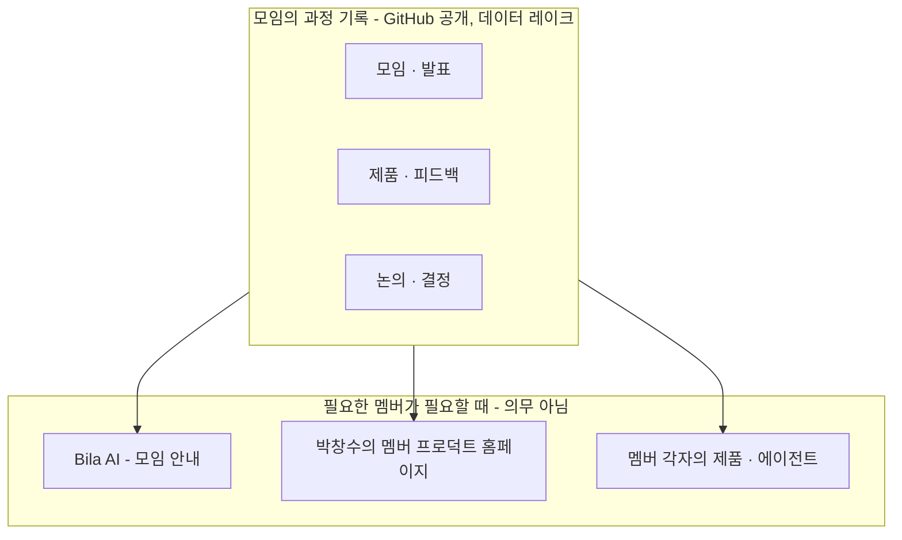

## 이 자료 쓰는 법

Live #35 1부에서 화면에 띄우고 AI 와 함께 고쳐 나갈 **출발점 초안**이다. 방송 결과는 **11월 말 Builders Lounge 모임에서 박창수가 직접 발표**할 자료(두 번째 세션, 11/7 확정)의 원본이 된다. 볼트의 기록(모임 정리 · 공지 · 뉴스레터 · 영상 인덱스 · 구상 문서 · 대화 정리 · 구술)을 방송 전에 읽어 세 부분으로 정리했다. 방송 화면에 띄워도 되도록 **다른 분의 이름 · 발언 원문 · 개인 수익 금액은 넣지 않았다**. 대화에서 나온 의견은 「간사 미팅」 「멤버 대화」처럼 자리만 밝힌다. 맨 아래 「출처」 절에는 공개된 모임 기록과 구상 문서만 링크했다.

각 칸의 표시는 이렇다. **사실**은 기록으로 확인된 것, **논의됨**은 대화에서 나왔지만 정해지지 않은 것, **빈칸**은 자료로 답이 나오지 않아 방송에서 정할 것이다.

## 1. 지난 6개월 — 배우는 모임에서 만드는 모임으로

### 걸어온 길

| 시기 | 일 | 의미 |
|---|---|---|
| 2026-03~04 | 창발 AI 스터디 그룹이 다시 모였을 때 「이제 배울 단계가 아니다」 — 각자 이미 무언가를 만들고 있었다 | 출발점 |
| 04-23 | 준비 모임에서 「이론 공부를 넘어, 각자 만든 것을 나누고 피드백을 주고받는 실전 빌더 커뮤니티로」 합의 | 방향 합의 |
| 05-07 | 1차 공식 모임(Bellevue City Hall) — 이름 공모 · 투표로 **Builders Lounge** 확정, GOBI Space 핸즈온 | 공식 출범 |
| 05-24~30 | 기록 저장소(GitHub) 공유, 홈페이지 · AI 코디네이터 구상 시작 | 기록 문화의 시작 |
| 06-08 | 2차 모임(온 · 오프 하이브리드) — 개발자와 비개발자가 만든 제품 5개 소개 | 「누구나 빌더」 확인 |
| 06-29 | Product Discovery Platform 구상 — Catch Up AI · Builders Lounge · Bila AI 세 축 | 연결 구조 구상 |
| 07-06 | 3차 — 워싱턴주 한인상공회의소와 커피챗 | 지역 비즈니스와 첫 연결 |
| 07-10 | 첫 뉴스레터 발송 | 소식 채널 |
| 08-06 | 4차 모임 11명 — 발표 4편(메인은 코딩을 모르던 목회자의 앱), **Bila AI 첫 소개** | 비개발자 빌더 · AI 멤버 |
| 09-16 | 5차 모임 — 멀티에이전트 시스템 발표 2편 | 깊이 |
| 09-25 | 「교집합 성장」 구상 · 청사진 — 모임과 멤버, 멤버와 멤버의 겹치는 부분을 함께 키운다 | 성장 모델 구상 |
| 10-10 | 창발 테크 서밋(CTS 2026) 홍보 부스 | 첫 대외 홍보 |
| 10-14~ | 지역 한인 신문 기사 · 「빌더스 라운지 칼럼」 연재 시작 | 미디어 |
| 10-21 | **첫 온라인 특강**(비엔지니어 대상) — Luma 등록 약 80명, Teams 참여 66명 | 규모의 전환 |
| 10-25 | 간사 온라인 미팅 — 어디까지 키울지, 누가 무엇을 맡을지 | 내년 논의 시작 |
| 10-25 | 멤버 둘이 온라인으로 만나 각자 만드는 AI 프로덕트와 인사이트를 나눔 → 공동 제작 영상(11/7 업로드) | 둘이서 여는 빌더 모임의 첫 사례 |
| 10-30 | 8차 뉴스레터 | — |
| 11-03 · 04 | 멤버 대화, 송이 채취 중 한 해 회고 | 이번 정리의 재료 |
| 11월 말 | 올해 마지막 모임 — 스타트업 빌더 이야기(섭외 중) | 예정 |

### 숫자로 본 6개월

| 항목 | 값 | 비고 |
|---|---|---|
| 공식 모임 | 5회 + 온라인 특강 1회 | 3차는 커피챗 |
| 공개 영상 | 9편 | 모임 발표 8편 + 특강 1편, 한 재생목록 |
| 뉴스레터 | 8호 | 7/10 첫 호 |
| 가장 큰 모임 | 등록 약 80 · 참여 66(Teams 기록) | 10/21 온라인 특강. 이전 오프라인은 회의실 10명 규모 |
| 온라인 공간 | GOBI Space 창발 Space 의 Builders Lounge 채널 + 창발 Slack | Bila AI 가 모임 기록으로 답함 |

### 무엇이 바뀌었나

| 처음 | 지금 | 계기 |
|---|---|---|
| 공부하는 스터디 | 만든 것을 보여 주고 서로 써 보는 모임 | 4월 합의 |
| IT 엔지니어 중심 | 비개발자 · 시니어 · 크리에이터까지 | 2차 · 4차 발표, 10월 특강 |
| 시애틀 오프라인 | 지역 제한 없음, 온라인으로 확장 | 회의실 인원 한계 → 10월 온라인 특강 |
| 사람이 정리하는 기록 | 기록이 Bila AI 의 Context 가 됨 | 5월 저장소 → 8월 Bila AI |
| 모임 하나 | 상공회의소 · 창발 · 지역 신문과 연결 | 7월 커피챗, 10월 부스 · 칼럼 |

**올해 두 가지 노력** (간사 미팅 · 멤버 대화에서 공통으로 나옴, 논의됨): ① 「꾸준히 한다」는 신뢰를 쌓는다 — 발표가 끊이지 않게 ② 다양성 — 비IT 발표 · 비IT 대상 강의 · 스타트업까지 폭을 넓힌다.

### 빈칸 — 방송에서 채울 것

- 6개월 중 박창수가 **가장 잘했다고 보는 것** 하나와 **아쉬운 것** 하나
- 「기록 → Bila AI」는 실제로 얼마나 쓰였나 — 쓰임이 적었다면 왜인가
- 피드백(서로의 첫 사용자)은 모임 안에서 실제로 일어났나, 발표 중심으로 흘렀나

## 2. 빌더스라운지의 정체성

### 지금까지 나온 정의들

| 언제 | 정의 | 상태 |
|---|---|---|
| 04-23 준비 모임 | 이론 공부를 넘어, 각자 만든 것을 나누고 피드백을 주고받는 실전 빌더 커뮤니티 | 사실(합의) |
| 공식 소개 | 슬로건 **Build. Share. Grow. Together.** / 5가지 방향성: Practical Build · Builder for Builders · Workflow Sharing · Collective Intelligence · Open Ecosystem | 사실 |
| 09-25 | 모임과 멤버, 멤버와 멤버 사이의 교집합을 찾아 함께 키우며 같이 성장하는 곳 | 박창수 구상 |
| 10-25 간사 미팅 | 안에서는 「빌더스」, 밖에서는 「미국 한인의 AI 활용 모임」처럼 쉽게 / 빌더는 앱 개발자만이 아니라 AI 로 워크플로우 · 글 · 콘텐츠를 만드는 모든 사람 | 논의됨 |
| 11-03 박창수 | 다양한 빌더가 모여 서로의 프로덕트를 소개하고, 써 보고, 피드백을 주고받고, 그 과정을 기록으로 남겨 AI Context 로 활용한다 | 박창수 기준 |
| 11-07 박창수 | 과정을 계속 기록하고, 그 기록은 사람뿐 아니라 AI 에이전트를 위한 것이다. GitHub 에 있어 누구나 접근하는 **일종의 데이터 레이크** — 멤버라면 누구나 필요할 때 자기 제품 · 에이전트에서 쓸 수 있다(의무 아님). 데이터는 하나, 쓰임은 목적에 따라 여럿 | 박창수가 가장 신경 쓰는 특징 |

### 박창수가 가장 신경 쓰는 특징 — 하나의 기록, 여러 쓰임

기록은 **모두의 것**(정체성)이고, 그 기록을 어떻게 쓰는지는 **각 멤버의 선택**이다. 박창수의 홈페이지는 여러 쓰임 중 하나일 뿐이다.

### 모임은 매달 전체 모임만이 아니다 (11/7 박창수)

누구나 **둘 이상이 따로 모여** 각자 만드는 AI 프로덕트를 소개하고 AI 를 쓰며 얻은 인사이트를 나눌 수 있다. 그 내용을 기록할 수 있게 내 주면 **그것도 빌더스라운지 활동**이 된다. 10/25 멤버 둘의 온라인 미팅이 첫 사례다. 모임의 크기가 아니라 **만든 것을 나누고 기록하는가**가 빌더스라운지 활동의 기준이 된다 — 그래서 기록이 앞의 데이터 레이크로 모인다.

| 활동 | 누가 | 기록 |
|---|---|---|
| 정기 모임 | 모임 전체, 매달 — 항상 온라인으로 열림, 오프라인 모임도 온라인 접속 가능 | 운영진이 정리 · 영상 공개 |
| 빌더 소모임 | 누구나 둘 이상 | 모인 사람이 기록을 내 줌 → 공개 기록에 합류 |

### 한 문장 후보 (방송에서 하나로)

- **A — 기존 계승**: AI 로 무언가를 만드는 사람들이 서로의 첫 사용자가 되어 주고, 그 과정을 기록해 함께 성장하는 모임
- **D — 기록 중심 (11/7)**: 만든 것을 나누는 과정을 모두 기록하고, 그 기록을 사람과 AI 에이전트 누구나 쓸 수 있게 공개하는 빌더 모임
- **B — 쉬운 대외용**: AI 를 일과 생활에 써 보며 만든 것을 나누는 한인 AI 활용 모임
- **C — 2027 지향**: AI 를 쓰는 사람들이 만나 경험을 나누고, AI 가 줄 수 없는 「사람의 정보」로 서로를 키우는 네트워크

### 정체성에서 의견이 갈리는 지점 (논의됨)

| 쟁점 | 한쪽 | 다른 쪽 |
|---|---|---|
| 빌더 vs 크리에이터 | 만드는 사람(빌더) | 콘텐츠와 앱의 경계가 흐려져 크리에이터에 가깝다 |
| 무엇이 자산인가 | 멤버들이 꾸준히 만들 수 있는 「무대」를 주는 것 | 남의 필요를 찾아 바로 맞춤 해법을 만드는 능력(FDE) — 앱 자체는 복제가 쉽다 |
| 수익 방향 | 지적 만족 → 한인 소상공인 · 비즈니스의 수익과 효율에 도움 | 사업화보다 창작이 이어지는 무대가 먼저 |
| 문턱 | 문턱이 조금 있어야 소속감이 생긴다 | 소식은 문턱 없이, 참여할 때 가입(2단계) |
| 범위 | 시애틀 로컬로 밀도 있게 | 온라인으로 모으고 그 안에서 로컬 모임이 생기게 |

### 선 긋기 — 정체성 vs 멤버의 개인 계획

정체성은 **모두의 모임**에 대한 것이다. 과정을 기록하고 그 기록을 멤버에게 공개하는 것까지가 정체성이다. 멤버는 그 정체성 아래서 모임의 리소스(기록 · 네트워크 · 발표 자리)를 필요할 때 자기 프로덕트에 쓸 수 있다. 박창수의 홈페이지 구상은 **한 멤버로서의 개인 Product 플랜**이며 4절에서 따로 다룬다.

### 빈칸 — 방송에서 채울 것

- 한 문장 정의를 A · B · C · D 중 무엇으로, 또는 어떻게 섞을지
- 「하나의 기록, 여러 쓰임」을 발표에서 어떻게 보여 줄지 — 기록이 실제로 쓰인 예(Bila AI 답변 등)를 무엇으로 들지, 멤버가 기록을 쓰려면 무엇을 알아야 하는지(위치 · 형식 · 공개 범위)
- 「빌더」라는 이름을 유지할지, 대외 표현을 따로 둘지
- 위 다섯 쟁점 중 박창수의 입장 — 단, 이것은 **11월 모임에 가져갈 제안**이다

## 3. 2027 계획 — 지금까지 나온 논점

### 연도별 주제 (박창수 구상)

| 해 | 주제 |
|---|---|
| 2025 | 재미로 하는 바이브 코딩 |
| 2026 | 일에 AI 를 적용하는 실험 — 만드는 모임으로 |
| **2027** | **AI 를 쓰는 사람들의 네트워킹이 만드는 시너지와 새 가치** — AI 가 주는 정보는 누구나 얻으니, 사람의 새로운 시도 · 경험과 그 사람을 직접 만나는 연결이 차별이 된다 |

### 영역별 논점

| 영역 | 나온 이야기 | 상태 |
|---|---|---|
| 운영 구조 | 간사 모임을 2주에 한 번 짧게 / 간사 확대 | 논의됨 |
| 역할 분담 | 모임 코디네이션을 에이전트로(섭외 · 일정 · 홍보 · 매칭) / AI 에이전트 도구 정리와 매칭 / 일상생활 AI 활용 사례 발표 · 콘텐츠 | 제안 |
| 모임 형식 | **전체 모임은 항상 온라인으로 열려 있고, 오프라인으로도 모이며, 오프라인 모임에도 온라인 접속이 가능하게 한다**(11/7 박창수) / 발표가 끊이지 않게 / 내년 여름 큰 행사 한 번(기대) | 박창수 기준 · 나머지 논의됨 |
| 빌더 소모임 | 누구나 둘 이상 따로 모여 프로덕트 · 인사이트를 나누고 기록을 내 주면 빌더스라운지 활동(11/7 박창수). 기록을 어떻게 내는지(양식 · 형식 · 공개 동의)는 정해야 함 | 박창수 기준 |
| 대상 | 개발자 → 일반 사용자 · 시니어 · 크리에이터 · 소상공인 · 스타트업 | 논의됨 |
| 채널 | 소셜(Threads · X 해시태그)은 발견 창구, GOBI Space 와 에이전트는 지식 레이어 / 플랫폼 의존 우려 | 논의됨 |
| 기록과 AI | Bila AI 가 기록으로 답함(구현) → 비슷한 일을 하는 사람 매칭 → 모임 코디네이팅 에이전트. 매칭은 사람들이 자기 것을 공개해야 의미 | 일부 구현 |
| 쇼케이스 | GitHub 은 일반인에게 어렵다 → 만든 것을 한눈에 보는 공간이 있으면 대외 홍보에 좋다 | 논의됨(여러 자리에서) |
| 외부 연계 | 상공회의소 행사 · 공모전을 팀으로 / 스타트업과 지역 기업 매칭 | 논의됨 |
| 모임 재원 — 기본 운영비 | **2027 계획에 반드시 포함**(11/7 박창수). 박창수 개인의 수익 추구와는 별개로, 모임 자체의 지속 가능성을 위해 기본 운영비를 마련할 방법을 찾는다. 후보: 비영리법인 · 후원 · 도네이션 · 자체 수익 · 유료 뉴스레터 · 외부 공모전 팀 참여. 간사 미팅에선 「규모가 커진 뒤」라는 의견도 있었다 | 박창수 기준 · 방법은 리서치 전 |

### 빈칸 — 방송에서 채울 것

- 2027 주제 문장 확정, 그리고 그 주제가 **모임 형식으로 어떻게 보이는지** (예: 분기마다 무엇을 하나)
- 모임 주기와 형식 — 월 1회 유지? 온라인은 항상 열려 있으니(11/7), 오프라인은 얼마나 자주 · 어디서 · 하이브리드 장비와 진행은 어떻게?
- 빌더 소모임을 어떻게 권하고 기록을 받을지 — 기록 양식(누가 · 무엇을 · 인사이트 · 공개 동의), 녹화 · 전사 도움, 정기 모임에서 소개하는 방법
- 역할 — 박창수가 **계속 맡을 것**과 **넘기고 싶은 것**
- 기본 운영비 — 다룰지는 정해졌다(11/7: 계획에 포함). 정할 것은 ① 기본 운영비에 무엇이 드나(장소 · 도구 구독 · 에이전트 토큰 · 영상 · 행사) ② 어떤 방법을 먼저 알아볼지 ③ 언제까지 어떤 형태를 갖출지 ④ 개인 수익과 모임 재원의 경계를 발표에서 어떻게 설명할지
- 2027 말에 「잘됐다」고 말할 기준 2~3개

## 4. 부록 — 박창수 개인 Product 플랜: 멤버 프로덕트 홈페이지

> 빌더스라운지의 공식 활동이 아니다. 한 멤버가 모임의 리소스를 활용해 만드는 제품이다.

| 시기 | 구상 | 핵심 |
|---|---|---|
| 05-24 | Custom Homepage 기능 구상 | 제품 소개 → 실제 사용 → 구조화된 피드백 → 개선 기록. 첫 버전은 제품 쇼케이스 · 피드백 요청 · 리뷰 템플릿 |
| 06-29 | Product Discovery Platform | Catch Up AI(소개) · Builders Lounge(사용 · 피드백) · Bila AI(매칭) 세 축 |
| 10~11월 대화들 | 만든 것을 보여 줄 공간이 필요하다는 의견이 여러 자리에서 공통으로 나옴 | GitHub 은 일반인에게 어렵다 |
| 11-03 | 공개 기록(GitHub 후보)을 모니터링해 홈페이지에 반영, 멤버가 직접 입력, 누구나 보고 · 쓰고 · 피드백. 같은 기록을 GOBI Space 와 다른 멤버의 에이전트 · 제품이 함께 씀 | 기록이 중심, 홈페이지는 여러 활용처 중 하나 |

방송에서는 AI 가 이 흐름을 근거로 **목적 가설 → 사용자별 기능 → 첫 버전 범위**를 제안하고 박창수와 의논한다(홈페이지 의논 프롬프트). 11/9 협업 미팅에서 이야기할 거리도 여기서 나온다.

## 출처

- 모임 기록: [[Initiatives/Builders Lounge/README|README]] · [[Initiatives/Builders Lounge/videos/Builders Lounge 영상 인덱스 (플레이리스트)|영상 인덱스]] · [[Initiatives/Builders Lounge/videos/Builders Lounge 모임 전체 FAQ (1~5차)|모임 FAQ]] · [[Initiatives/Builders Lounge/ideas/2026-09-23 CTS 2026 Builders Lounge 홍보 부스|CTS 부스]]
- 구상: [[Initiatives/Builders Lounge/ideas/2026-05-24 Builders Lounge Custom Homepage 기능 구상 - ChatGPT|Custom Homepage]] · [[Initiatives/Builders Lounge/ideas/2026-06-29 Builders Lounge Product Discovery Platform 구상|Product Discovery Platform]] · [[Initiatives/Builders Lounge/ideas/2026-09-25 Builders Lounge 교집합 성장 구상 - 모임과 멤버가 함께 키우는 비지니스|교집합 성장]]
- 대화 정리: 간사 미팅(10/25) · 멤버 대화(11/3) · 송이 채취 회고(11/4)의 정리 문서 — 다른 분의 발언이 담겨 있어 공개하지 않는다. 이 자료에는 요지만 옮겼다.
- 구술: 박창수 구술(11/3 · 11/5 · 11/7) — 원문은 개인 기록에 보존
