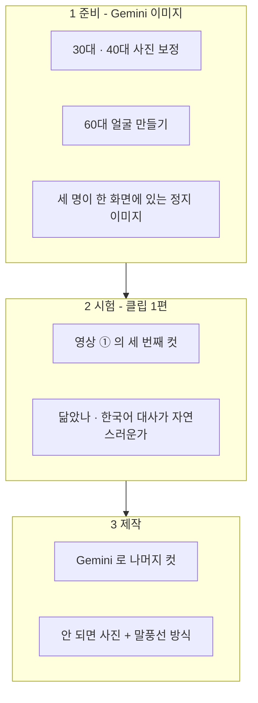

## 이 문서에 대해

[[Initiatives/Builders Lounge/planning-2027/2026-11-13 11월 모임 발표 구성안 by Claude Code|발표 구성안]]의 영상 ① · ② · ③ 콘티다. 30대 · 40대 · 50대의 박창수가 만나 이야기하고, 클로징에는 60대가 등장한다(11/13 박창수 채택). 목소리는 Gemini 가 영상과 함께 만드는 음성을 그대로 쓴다 — 음성과 입 모양이 맞도록(11/13 박창수). 대사는 모두 Claude 가 쓴 초안이라 박창수가 고쳐 쓴다.

## 사진 상태

| 나이 | 파일 | 상태 | 먼저 할 일 |
|---|---|---|---|
| 30대 | `changsoo_30th.png` | 증명사진, 폴로 셔츠, 화질 낮음 | 화질 보정 |
| 40대 | `changsoo_40th.png` | 신분증을 찍은 사진 — 홀로그램 무늬와 「LIVE」 표시가 얼굴 아래에 겹침 | **홀로그램 · 표시 제거와 화질 보정이 필요** |
| 50대 | `changsoo_50th.jpg` | 깨끗한 프로필 사진(400px) | 그대로 사용 가능 |
| 60대 | 없음 | — | 50대 사진을 10년쯤 나이 들게 만든다 |

## 만드는 순서



Gemini 영상은 한 컷이 8초 안팎이라 컷마다 대사를 한두 문장으로 짧게 쓴다. 컷을 이어 붙이는 일과 자막은 Remotion 이나 편집 도구로 한다. 시험에서 얼굴이 닮지 않거나 한국어 대사가 어색하면, 슬라이드에 이미 들어 있는 **사진 + 말풍선** 방식을 그대로 쓴다(지금 HTML 초안의 기본 화면).

## 영상 ① — 오프닝 (슬라이드 1, 세 컷 약 24초)

| 컷 | 누가 · 어디서 | 대사(안) | 화면 |
|---|---|---|---|
| 1-1 | 30대, 2000년대 사무실 | 「AI 요? 그건 영화에나 나오는 거 아닌가요?」 | 두꺼운 모니터 앞에서 고개를 갸웃한다 |
| 1-2 | 40대, 2010년대 사무실 | 「AI 가 바둑을 이겼다던데요. 그래도 제 일이랑은 상관없겠죠?」 | 휴대폰 뉴스를 보다가 어깨를 으쓱한다 |
| 1-3 | 50대, 지금 | 「두 분, 놀라지 마세요. 지금은 말로 하면 AI 가 앱을 만들어 줍니다. 그래서 우리가 모였습니다.」 | 세 명이 한 테이블에 앉아 있고 30대 · 40대가 놀란다 |

## 영상 ② — 2부 중간 (슬라이드 12, 두 컷 약 16초)

| 컷 | 누가 | 대사(안) | 화면 |
|---|---|---|---|
| 2-1 | 40대 | 「그럼 그 똑똑한 AI 에이전트, 모임에서 하나 만들어 주면 되겠네요?」 | 기대하는 표정으로 묻는다 |
| 2-2 | 50대 | 「아니요. 각자 만듭니다. 우리는 빌더니까요.」 | 웃으며 고개를 젓는다. 30대가 뒤에서 「저도요?」 하는 표정 |

## 영상 ③ — 클로징 (슬라이드 25, 두 컷 약 16초)

| 컷 | 누가 | 대사(안) | 화면 |
|---|---|---|---|
| 3-1 | 60대, 2030년대 | 「그때 쌓아 둔 기록, 지금도 잘 쓰고 있습니다. 고마워요.」 | 문을 열고 들어와 세 명에게 인사한다 |
| 3-2 | 60대 + 세 명 | 「계속 만나세요. 사람의 경험은 만나야 얻습니다.」 | 네 명이 함께 카메라를 본다 |

## Gemini 프롬프트 (시험 클립 — 컷 1-3)

먼저 정지 이미지를 만든다. 보정한 30대 · 40대 사진과 50대 사진을 함께 올리고 아래처럼 요청한다.

```text
Using the three reference photos of the same Korean man at different ages (in his 30s, 40s, and 50s),
create one photorealistic image: the three of them sitting together at a wooden cafe table,
facing each other in friendly conversation. Keep each face faithful to its reference photo.
The 30s version wears a casual polo shirt, the 40s version a sweater over a collared shirt,
the 50s version a navy blazer with a light blue shirt. Warm indoor light, 16:9.
```

그 이미지를 올리고 영상을 요청한다.

```text
Animate this image into an 8-second video with natural lip-sync and Korean speech.
The man in the navy blazer (50s) speaks warmly in Korean:
"두 분, 놀라지 마세요. 지금은 말로 하면 AI 가 앱을 만들어 줍니다. 그래서 우리가 모였습니다."
The two younger versions listen, then look surprised. Gentle camera push-in, no background music.
```

## 확인할 것

| # | 물음 |
|---|---|
| 1 | 대사 — 박창수의 30대 · 40대가 실제로 했을 법한 말로 고치기 |
| 2 | 시험 클립 결과로 Gemini 방식과 말풍선 방식 중 확정 |
| 3 | 영상 생성은 박창수 계정의 Gemini 에서 진행 — Claude 는 프롬프트 · 이어 붙이기 · 자막을 맡는다 |
