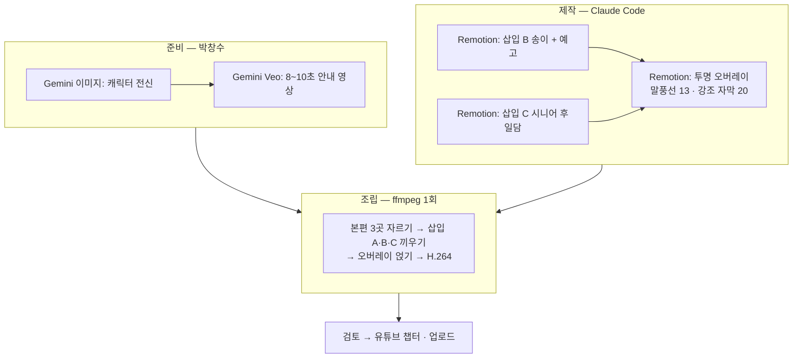

## 한눈에

**본편**: `C:\Users\dougg\Videos\Youtube\2026\Builders_Lounge\20261025_Jinyoung\1103_before_text.mp4` (35:55 · 1920×1080 · 30fps · HEVC) → [[Initiatives/Builders Lounge/videos/2026-10-25 김진영 님 온라인 미팅 Transcript by Claude Code|Transcript]]

박창수 요청(11/7)은 다섯 가지다. ① 인트로(00:00~01:42) 뒤에 Catch Up AI 캐릭터가 한국어로 안내하는 10초 Gemini 영상 ② 송이버섯 대목에 실제 채취 장면과 다음 영상 예고 ③ Kent 시니어 이야기 뒤에 그 후 이야기(이메일 보내기 · 메뉴판 직접 제작) ④ 중간중간 캐릭터가 나와 다음 이야기를 안내 ⑤ 중요한 말은 화면 텍스트로 강조.

**추천: 지난 송재희 특강 때 검증한 방식을 넓혀 쓴다.** 35분 본편을 Remotion 안에서 통째로 렌더링하면 이 PC(15W CPU · GPU 없음)에서 몇 시간이 걸린다. 그래서 Remotion 은 **짧은 조각만** 만들고, 본편은 ffmpeg 로 자르고 잇는다. 텍스트와 캐릭터 말풍선은 **투명 배경 조각**으로 렌더링해 같은 ffmpeg 패스에서 얹으므로, 본편 재인코딩은 **딱 한 번**(백그라운드 40~70분)이다. → 선례: `AI/RemotionStudio/src/bl-lecture-song-1027/` (`assemble.py` · `video-slide-plan.md`)



## 1. 타임라인 (본편 시각 기준)

| 본편 시각 | 넣을 것 | 길이 | 방식 |
|---|---|---|---|
| 00:00~01:42 | 인트로(원본 그대로) | — | — |
| **01:42** | **삽입 A** — Catch Up AI 캐릭터가 오늘 이야기를 안내 | 8~10초 | Gemini Veo (박창수 생성) |
| 26:34~26:53 | 박창수: 「올해가 송이버섯이 그렇게 풍년이…올해도 한 번 그러기를 기대를 하고 있는데」 | — | 원본 |
| **26:53** | **삽입 B** — 「그리고 11월 4일, 실제로 다녀왔습니다」 송이 채취 장면 + 다음 영상 예고 | 15~18초 | Remotion (IMG_5574 편집) |
| 31:44~33:05 | 박창수: Kent 에서 데리야키 하시는 60대 분께 Muse 안내 · Gmail · Google Calendar 연결 | — | 원본 |
| **33:05** | **삽입 C** — 「그 후 이야기」 이메일 확인 → 직접 보내기 → 메뉴판 직접 제작 | 12~18초 | Remotion |
| 전 구간 | 챕터 말풍선 13개 · 강조 자막 약 20개 | 각 4~6초 | Remotion 투명 오버레이 |

삽입 셋을 더하면 전체 길이는 약 **36분 35초**가 된다. 끼우는 점은 무음 구간 가운데로 프레임 단위로 맞춘다.

**삽입 B 를 26:53 에 두는 이유**: 미팅은 10/25 이고 채취는 11/4 다. 「풍년이라는데 가 보고 싶다」는 말 바로 뒤에 「그리고 실제로 다녀왔습니다」로 이으면 이야기가 자연스럽게 이어진다. IMG_5574(44초 · 1280×720)에서 버섯을 발견하고 캐는 손이 보이는 24~36초 근처를 8~12초 쓰고, 끝 5~6초는 예고 카드다.

> 다음 영상 예고(안): 「송이버섯을 따며 돌아본 2026년의 AI 와 Builders Lounge, 그리고 2027년 계획 — 다음 영상에서 만나요!」

**삽입 C 를 33:05 에 두는 이유**: 박창수가 「결과는 아직 보지는 못했는데」라고 말하고 「그 도움을 Muse 가 대신 줄 수가 있는 거죠」(33:00)로 마무리한 직후다. 그 약속에 대한 답을 바로 보여 줄 수 있다.

> 그 후 이야기(확정 내용, 11/7 박창수): **1회차** Muse 로 이메일 확인 · 직접 보내기까지 → **2회차** 운영하시는 식당 메뉴판을 Muse 로 직접 만들기. 수업은 주 1회이며 2회차 뒤에는 그분이 한국에 가셔서 쉬는 중이다

## 2. Catch Up AI 캐릭터 만들기 (삽입 A 와 말풍선에 같이 쓴다)

| 단계 | 하는 일 | 도구 |
|---|---|---|
| ① | 로고의 얼굴만 남기고 **몸까지 있는 전신 캐릭터** 이미지를 만든다(정면 · 손 흔드는 자세 2장) | Gemini 이미지 생성 |
| ② | ①을 첫 프레임으로 넣어 **한국어 대사를 말하는 안내 영상**을 만든다 | Gemini 앱 Veo |
| ③ | ①의 배경을 지운 **투명 PNG** 를 말풍선 캐릭터로 쓴다 | 로컬 배경 제거 또는 Gemini |

Veo 는 한 번에 **8초 안팎**으로 만들어지는 경우가 많다. 대사를 8초 안에 맞추고, 10초가 필요하면 Remotion 에서 앞뒤로 로고 1초씩 붙인다. 프롬프트는 제작 단계에서 `video-prompts.md` 로 정리한다. 배경음악은 넣지 않고 대사만 쓴다(외부 음원 금지 규칙 — 필요하면 코드로 합성한 음악을 낮게 깐다).

> 삽입 A 대사(안, 약 8초): 「안녕하세요, Catch Up AI 예요! 오늘은 두 빌더가 AI 를 어떻게 쓰는지, 그리고 그 속에서 얻은 인사이트를 들어 봅니다. 함께 보실까요?」

중간 안내(④)는 Veo 영상을 여러 개 만들지 않고, **같은 캐릭터 PNG 가 화면 오른쪽 아래에서 튀어나와 말풍선으로 다음 이야기를 알려 주는 방식**(무음)으로 한다. 목소리가 클립마다 달라지는 문제가 없고, 생성 시간과 비용도 들지 않는다.

## 3. 챕터 말풍선 (초안 · 13개)

유튜브 챕터에도 그대로 쓴다. 시각은 본편 기준이며 조립 때 삽입 길이만큼 자동으로 밀어 준다.

| 시각 | 말풍선 |
|---|---|
| 01:42 | 진영 님의 AI 셋업 — Mac Studio 와 Codex 원격 |
| 03:47 | 나를 주인공으로 한 AI 콘텐츠 · 이북 번역 리더 · AI 작곡 |
| 08:43 | AI 는 소비자를 생산자로 바꾼다 |
| 09:50 | 비개발자의 첫걸음 — 나를 위해 먼저 만들기 |
| 11:48 | 얼마 들었을까? 그리고 원격 작업에서 배운 것 |
| 18:20 | 노트북 없이 일하기 — Muse |
| 20:12 | AI 로 만든 콘텐츠, 사람들은 어떻게 볼까? |
| 26:08 | 나만의 고유성 — 현장으로! |
| 29:36 | 오프라인 행사, 사람에게서 받는 에너지 |
| 31:00 | 시니어에게 AI 를 — Muse 가 바꾼 것 |
| 33:14 | 사람의 목소리가 귀해지는 시대 |
| 34:15 | AI 시대, 네트워킹이 더 중요해진다 |
| 35:23 | 다음 Builders Lounge 모임 예고 |

## 4. 강조 자막 (초안 · 화면 아래쪽 1/3)

| 시각 | 자막 |
|---|---|
| 02:07 | Mac Studio M5 · 64GB — 로컬 AI 모델을 직접 돌린다 |
| 02:45 | Codex 하나로 노트북 · 태블릿 · 폰에서 서버를 제어 |
| 05:58 | 직접 만든 이북 리더 — 읽으면서 바로 한국어 번역 |
| 06:42 | AI 가 반주를 붙여 주는 작곡 · 피아노 연습 앱 |
| 09:03 | 소비 → 생산 |
| 11:28 | 나와 가족부터 — 요구사항이 분명해진다 |
| 12:32 | 총 약 $4,000 (SSD 2TB 추가 포함) |
| 13:01 | Apple 리스도 있다 — 64GB 모델 월 약 $75 |
| 14:47 | 원격 작업이 멈추는 주된 이유: 권한(permission) |
| 15:36 | SSH · 원격 데스크톱 · Tailscale 을 함께 |
| 16:14 | Chrome Remote Desktop — 무료로 내 화면 원격 접속 |
| 17:56 | 이미지 생성의 약 80% 는 로컬 모델로 |
| 23:00 | 작업 시간은 절반, 에너지는 1/10 |
| 24:44 | 제안: AI 콘텐츠에도 레벨을 나누자 |
| 27:03 | 콘텐츠 3가지 — 직접 만든 것 · 네트워킹 · 세미나 취재 |
| 28:48 | Remotion 에게 「지난번과 다르게, 새 효과를 더해」 |
| 30:26 | AI 가 못하는 것 — 새로운 경험, 사람의 에너지 |
| 31:18 | 설치가 장벽이었다 → Muse 가 중간 단계를 없앴다 |
| 32:35 | Muse + Gmail + Google Calendar 연결 |
| 34:00 | 사람의 경험 · 생각 · 목소리가 귀한 시대 |
| 35:26 | 다음 모임: 11월 말~12월 초 · 스타트업 하는 빌더들 |

숫자(가격 · 리스료 · 80%)는 말한 그대로 옮겼다. 리스료는 「70불 정도」라고 했다가 「75 × 36」으로 계산했으므로 「약 $75」로 두었다. 영상을 보며 맞는지 확인한다.

## 5. 작업 순서와 시간

| 단계 | 누가 | 내용 | 예상 |
|---|---|---|---|
| 1 | 박창수 | 이 Plan 의 결정 사항(6절) 답하기 · 로고 파일 위치 알려 주기 | 10분 |
| 2 | Claude Code | 말풍선 · 자막 문구 확정본, 캐릭터 이미지 · Veo 프롬프트(`image-prompts.md` · `video-prompts.md`) | 20분 |
| 3 | 박창수 | Gemini 로 캐릭터 이미지 · 안내 영상 생성 → 폴더에 저장 | 20~40분 |
| 4 | Claude Code | Remotion 조각(삽입 B · C, 오버레이) 제작 → Studio 미리보기 검토 | 1~2시간 |
| 5 | Claude Code | 조각 렌더링 → `assemble.py` 로 최종본 조립(본편 재인코딩 1회) | 백그라운드 1시간 안팎 |
| 6 | 박창수 | 최종본 검토 → 수정 사항이 있으면 오버레이만 다시 렌더링 | 30분 |
| 7 | Claude Code | 유튜브 제목 · 설명 · 챕터(3절 기준) | 10분 |

**CapCut 으로 직접 하시는 경우**: 3 · 4절 표가 그대로 작업 목록이다. 텍스트를 먼저 넣고 삽입 A · B · C 를 나중에 끼우면 시각을 다시 계산할 필요가 없다. 삽입 B · C 와 캐릭터 말풍선만 Remotion 으로 만들어 드리고 나머지를 CapCut 에서 하는 **반자동**도 가능하다.

## 6. 결정된 것 (2026-11-07 박창수)

- **방식**: 자동(Remotion 조각 + ffmpeg 조립)으로 한번 시도한다
- **로고**: 받음 → `AI/RemotionStudio/public/jy-meeting-1107/images/catchupai-logo.png`
- **이름**: 박창수 대신 **Catch Up AI** 로 표기
- **송이 예고**: 캐릭터 **말풍선**
- **시니어 후일담**: 수업은 주 1회. **1회차에 이메일 보내기, 2회차에 메뉴판 제작**. 2회차 뒤 그분이 한국에 가셔서 이후 수업은 아직 없다 → 삽입 C 는 「1회차 · 2회차」 두 노드로 만들고, 메뉴판 사진 · 이름 · 식당 이름은 넣지 않는다
- **스타일**: 밝기 원장 권장과 본편의 검은 여백을 보고 **L3 딥네이비**로 정했다. 본편 오른쪽 아래에 Zoom 카메라가 있어 말풍선은 오른쪽 위에 둔다
- 제작 파일: `AI/RemotionStudio/src/jy-meeting-1107/video-slide-plan.md` · `public/jy-meeting-1107/image-prompts.md` · `video-prompts.md`

- **김진영 님 이름**: 공개해도 된다. 소개 자막은 「김진영 · Jin Young Kim — Builders Lounge 빌더 · 네이버 검색 US 디렉터」, 영상 끝에 진영 님 채널 **Jin Young Kim**(https://www.youtube.com/@lifidea) 안내. 채널 설명은 옛 팟캐스트용이라 쓰지 않는다 → [[Initiatives/Builders Lounge/builders/Kim-Jin-young-TrailsMap/profile|빌더 프로필]]
- **공동 제작**: 이 영상은 **김진영 님 유튜브 채널과 공동 제작**이다 → 영상 맨 처음 6초에 「공동 제작 Catch Up AI × Jin Young Kim」 배너를 띄우고, 유튜브 설명에도 적는다
- **에셋**: 캐릭터 이미지 3장(+투명 PNG 2장)과 삽입 A(10.03초, 대사 확인) 받음

아직 답이 없는 것: 강조 자막 숫자($4,000 · 월 $75 · 80%) 확인.

## 8. 완성 (2026-11-07)

**최종본**: `C:\Users\dougg\Videos\Youtube\2026\Builders_Lounge\20261025_Jinyoung\1107_final_with_inserts.mp4` (36:51 · 1920×1080 · H.264 · 211MB, 아웃트로 12초 포함). 제작 파일은 `AI/RemotionStudio/src/jy-meeting-1107/` (컴포지션 · `assemble.py`)에 있고, 고칠 때는 오버레이나 삽입만 다시 렌더링한 뒤 `assemble.py` 를 다시 돌린다(약 15분).

- **아웃트로(11/7 박창수 요청 추가)**: 12초 — 캐릭터 인사 「함께해 주셔서 감사합니다」 → 공동 제작 두 채널 카드(Catch Up AI youtube.com/@catchupai × Jin Young Kim youtube.com/@lifidea) → 다음 영상(송이) · 구독 안내. 엔딩 음악은 코드로 합성한 오리지널 곡
- 자르는 점: 본편 103.00 · 1614.12 · 1985.60초 (단어 시각 + 무음). 삽입 길이 A 10.03 · B 18.45 · C 15.06초
- 음량: 본편 −16.5 LUFS 기준으로 삽입 A +1.7dB · B +6.6dB
- 확인: 공동 제작 배너 · 이름 자막 · 01:43 이음새 · 송이 장면과 예고 · 그 후 이야기 · 마지막 채널 안내를 프레임으로 확인했다. 전체 시청은 박창수 몫

**유튜브 챕터(최종본 시각)**

```
00:00 인트로 — 오늘 나눌 이야기
01:43 Catch Up AI 의 안내
01:53 진영 님의 AI 셋업 — Mac Studio와 Codex 원격
03:57 나를 주인공으로 한 AI 콘텐츠 · 이북 번역 리더 · AI 작곡
08:53 AI는 소비자를 생산자로 바꾼다
10:00 비개발자의 첫걸음 — 나를 위해 먼저 만들기
11:58 얼마 들었을까? 그리고 원격 작업에서 배운 것
18:30 노트북 없이 일하기 — Muse
20:22 AI로 만든 콘텐츠, 사람들은 어떻게 볼까?
26:18 나만의 고유성 — 현장으로!
27:04 송이버섯 채취 현장 · 다음 영상 예고
30:04 오프라인 행사, 사람에게서 받는 에너지
31:28 시니어에게 AI를 — Muse가 바꾼 것
33:34 그 후 이야기 — 이메일, 그리고 메뉴판
33:57 사람의 목소리가 귀해지는 시대
34:58 AI 시대, 네트워킹이 더 중요해진다
36:06 다음 Builders Lounge 모임 예고
36:39 아웃트로
```

## 7. 처음에 정할 것으로 올린 목록 (기록)

1. **방식**: 자동(Remotion 조각 + ffmpeg 조립) / 반자동(삽입만 Remotion, 텍스트는 CapCut) / 전부 CapCut — 추천은 **자동**
2. **로고 파일**: 메시지에 「첨부한 로고」라고 하셨는데 파일이 오지 않았다. 경로를 알려 주시거나 다시 첨부해 주세요
3. **이름 표기**: 공개 영상 규칙에 따라 박창수 대신 「Catch Up AI · Builders Lounge」로 쓸지, 김진영 님 소개 문구(예: 직함)를 넣을지. **김진영 님의 공개 동의**도 Task 체크리스트에 남아 있다
4. **송이 예고 목소리**: 캐릭터 말풍선(무음) / 박창수 님이 직접 5초 녹음 / Veo 로 캐릭터 두 번째 클립 — 추천은 **말풍선**(박창수 님 목소리 복제는 쓰지 않음)
5. **시니어 후일담**: 이메일 보내기 · 메뉴판을 만드신 시점, **메뉴판 사진을 화면에 써도 되는지**(그분과 식당 이름 · 얼굴은 넣지 않는 것을 기본으로 한다)
6. **밝기 · 스타일**: 본편이 밝은 화면 공유 위주라 말풍선과 삽입 카드는 밝은 쪽(L1~L2)으로 간다. 제작 단계에서 효과 라이브러리를 보고 새 기법 2개 이상을 넣는다
