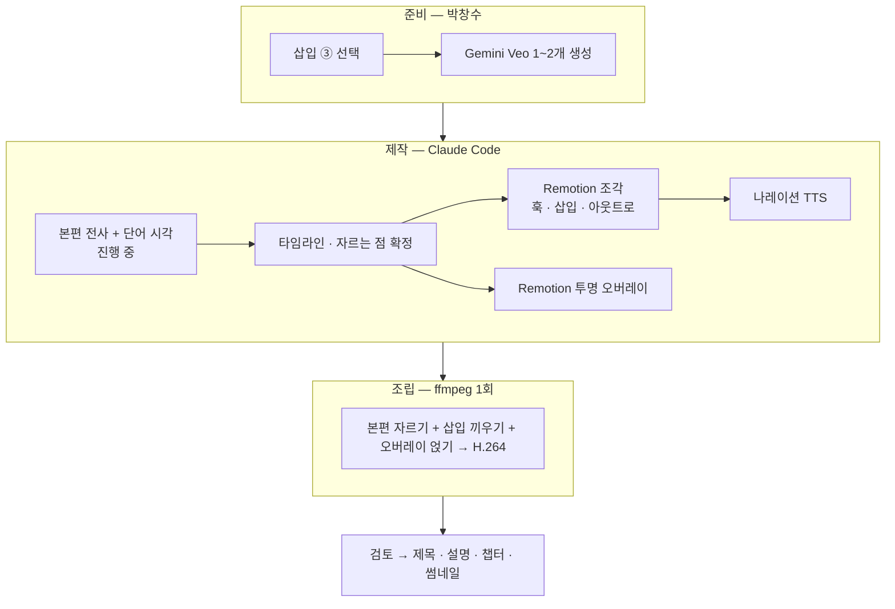

## 한눈에

**본편**: `C:\Users\dougg\Videos\Youtube\2026\Builders_Lounge\20261104_Songyi\materials\1109 (1).mp4` (31:17 · 1920×1080 · 30fps · HEVC · 2.4GB). 박창수가 불필요한 부분을 자르고 1.01배속으로 편집한 본편이며, 이야기 순서는 기존 Transcript(클립 IMG_5571~5597)와 같다.

**방식**: 김진영 님 영상(11/7)과 같다. 31분 본편은 Remotion 에서 렌더링하지 않는다(이 PC 에서 몇 시간 걸림). Remotion 은 **짧은 조각**(훅 · 삽입 슬라이드 · 아웃트로 · 투명 오버레이)만 만들고, 본편은 ffmpeg 로 자르고 이어 **한 번만** 재인코딩한다. 오버레이는 투명 ProRes 한 파일로 렌더링해 조각마다 따로 연다. → 선례 `AI/RemotionStudio/src/jy-meeting-1107/` (`assemble.py` · `overlays.tsx`)

**video-id**: `songyi-1110` → `src/songyi-1110/` · `public/songyi-1110/` · 작업 자료 `_staging/songyi-1110/` (원본 본편은 `public/` 에 복사하지 않는다)

**목표**: **오늘(11/10) 업로드 자료까지 완료.** 길이는 본편 31:17 + 훅 약 25초 + 삽입 슬라이드 2장(약 50초) + 아웃트로 약 25초 = **약 33분**

## 0. 결정 사항 (11/10 박창수)

| 질문 | 결정 |
|---|---|
| 개인 수익 목표 금액(한 달 약 $5,000) | **음성 · 자막 모두 공개해도 된다** |
| 결과표의 2024 년 | **쉰 해** → 그래프에 「2024 쉼」 |
| 온라인 특강 참여 인원 | **66명** (본편 음성은 64명이라 화면에 정정 표시) |
| 다음 모임 날짜(11/24) | **영상에 넣지 않는다** |
| 일정 | **오늘 완료** |
| 삽입 슬라이드 ③ | 설명을 듣고 정한다 → 5절 |

## 1. Opus 리뷰에서 고친 것 (v1 → v2)

| # | v1 의 문제 | v2 에서 |
|---|---|---|
| 1 | 훅이 「61개」뿐이라 숫자 하나로는 클릭 이유가 약하다 | 금액 공개가 허락돼 **「송이 61개 → 같은 산에서 세운 목표: AI 로 한 달 $5,000」** 두 숫자 훅으로 바꿨다. 본편 실제 음성 한 줄을 훅에 넣는다 |
| 2 | 15~30초 「이 영상으로 얻는 것」 예고가 없었다(첫 30초 규칙 3단계 누락) | 훅 끝에 **오늘 볼 것 4가지** 카드(61개 현장 · 빌더스라운지 6개월 · 2027 계획 · 경제적 목표)를 넣었다 |
| 3 | 앞 ① 현장 구간(원본 46분 중 약 20분)이 채취 장면만 길게 이어지는데 효과가 카운터뿐이었다 | 박창수가 **현장에서 직접 한 말**로 만든 「송이 메모」 카드 5~6개를 넣는다(새 정보를 지어내지 않음) — 3절 |
| 4 | Gemini 자료 7개는 오늘 안에 무리다 | **Veo 1개 필수 + 1개 선택**, 이미지는 0개로 줄였다. 삽입 슬라이드 배경은 본편 숲 장면을 흐리게 써서 영상과 이어지게 한다 — 7절 |
| 5 | TTS 를 edge-tts → 리뷰 → Qwen3 교체 → 리뷰로 두 번 돌리면 오늘 안에 어렵다 | 나레이션이 1분 안팎이라 **한 번만 리뷰**한다. 기본은 edge-tts 확정, 박창수가 원하면 Qwen3 로 한 번 교체 — 6절 |
| 6 | 전사가 청크 경계에서 문장을 빠뜨린 사고가 두 번 있었다(Task Board 기록) | 10분 청크로 받고 **경계 앞뒤 5초 이상 공백을 자동 검사**한다 |
| 7 | 공개 영상 이름 규칙이 빠졌다 | 화면 표기는 **Catch Up AI · Builders Lounge**. 박창수 이름은 화면에 쓰지 않는다 |
| 8 | 제목 · 썸네일 · 챕터가 마지막에 한 줄뿐이었다 | 8절에 방향을 미리 적었다 — 훅과 같은 두 숫자로 맞춘다 |
| 9 | 64/66 불일치 | 박창수가 「64명」이라고 말하는 순간 화면 칩 「Teams 참여 **66명**」 + 작은 「정정」 표시 |

## 2. 영상의 흐름 (본편 이야기 순서)

시각은 지금 전사 중인 편집본의 단어 시각으로 확정한다. 아래는 원본 클립 번호 기준이다.

| 토막 | 박창수가 하는 이야기 | 원본 클립 | 꾸밈 |
|---|---|---|---|
| ① 현장 | 풍년이라는 소문, 오자마자 송이 발견, 한 나무에서 10개, 가방이 꽉 차 돌아옴 | 5571~5587 | 채취 카운터 · 송이 메모 카드 |
| ② 왜 정리하나 | 송이를 찾아다니며 올해를 돌아보고 내년 계획을 세우려 했는데 틈이 없었다 | 5577 · 5588 | 말풍선 「오늘의 질문」 |
| ③ 시작 | AI 스터디 그룹 → 「이제 배울 단계가 아니라 만드는 단계」 → 5월 빌더스라운지 | 5588~5590 | **삽입 ① 지난 6개월** |
| ④ 지금까지 | 발표 5~6번 · 온라인 특강(등록 약 80 · 참여 66) · 다음 모임은 스타트업 빌더 | 5591 | 특강 썸네일 액자 · 숫자 칩(정정) |
| ⑤ 4분의 이야기 | 빌더가 만든 것을 보여 줄 공간 → 멤버 프로덕트 홈페이지 · GitHub 기록 · Bila AI | 5592~5593 | **삽입 ② 하나의 기록, 여러 쓰임** |
| ⑥ 사람이 주는 가치 | AI 정보는 누구나 얻는다, 사람의 시도와 경험은 만나야 얻는다. 2025 → 2026 → 2027 주제 | 5594 | 균사 그림 · (삽입 ③ 또는 오버레이) · 연도 타임라인 |
| ⑦ 경제적 가치 | 은퇴 후 소소한 AI 활용 가이드로 **한 달 $5,000** 꾸준한 수익 · 참여 부탁 · 일요일 라이브 | 5595 | $5,000 강조 자막 · CTA 예고 |
| ⑧ 마무리 | 오늘 61개 · 다시 AI 를 하러 간다 | 5596~5597 | 아웃트로로 연결 |

## 3. 앞부분 — 훅 · 결과표 · 캐릭터 안내 (약 45초, 본편 앞에 끼움)

| 시각 | 장면 | 소리 |
|---|---|---|
| 0:00~0:04 | 본편에서 가장 시원한 발견 장면 3~4곳을 0.8초씩 빠르게 컷 · 숫자 **0 → 61** 카운트업 | 본편 소리 그대로 |
| 0:04~0:09 | 「2020년 이후 하루 기록 **3위**」 → 화면이 숲으로 흐려지며 다음 줄 | 짧은 효과음(합성) |
| 0:09~0:15 | **같은 산에서 세운 2027년 목표** → 본편 실제 음성 한 줄 「한 달에 5천 불 정도의 꾸준한 수익」 + 큰 숫자 **$5,000 / 월** | 본편 음성 발췌(5595) |
| 0:15~0:22 | **오늘 볼 것 4가지**: 🍄 61개 현장 · 🏠 빌더스라운지 6개월 · 🗺️ 2027 계획 · 💵 AI 로 경제적 가치 | 나레이션 한 줄 |
| 0:22~0:40 | **결과표 그래프**: 연도 막대가 차오른다(아래 표). 마지막에 원본 표 이미지를 카드로 잠깐 보여 주고 줄어든다(「직접 기록」) | 나레이션 |
| 0:40~0:48 | **Catch Up AI 캐릭터 안내**(Veo, 한국어 8초) → 본편 시작 | Veo 대사 |

| 해 | 2020 | 2021 | 2022 | 2023 | 2024 | 2025 | 2026 |
|---|---|---|---|---|---|---|---|
| 합계 | 97 | 94 | 2 | 291 | 쉼 | 24 | **61 (하루)** |

- 6시즌 합계 **569개**(2020 = 33+61+3 · 2021 = 23+71 · 2023 = 112+179 계산 확인)
- 하루 기록 순위: 100(2023-10-24) · 66(2023-11-07) · **61(2026-11-04)**
- 결과표 이미지의 장소 표기 「Gifford Pinchot National Forest near Mt. Rainier」를 그래프 아래에 출처로 쓴다

**훅 나레이션(안)**: 「올해 레이니어산에서 하루에 딴 송이, 61개. 그리고 그 산에서 내년 목표도 세웠습니다. 오늘 영상에서는 송이 현장과 빌더스라운지의 6개월, 2027년 계획, 그리고 AI 로 경제적 가치를 만드는 도전까지 함께 보실 수 있어요.」

## 4. 본편 위에 얹는 효과 (오버레이 — 본편을 자르지 않음)

오른쪽 위는 캐릭터와 말풍선 자리, 아래 왼쪽은 자막 자리, 왼쪽 위는 채취 카운터 자리다. 한 화면에 카드는 하나만 띄운다.

| 종류 | 내용 | 개수 |
|---|---|---|
| 챕터 말풍선 | 캐릭터가 위에서 내려와 다음 이야기를 안내(FX-42). 유튜브 챕터에도 그대로 쓴다 | 9 |
| 채취 카운터 | 왼쪽 위 칩 「🍄 14 / 61」. 박창수가 세는 장면(4개 · 9개 · 14개 · 10개 · 61개)에서 올라간다. 편집본에서 빠진 장면이 있으면 그 숫자는 건너뛴다 | 4~5 |
| **송이 메모 카드** (새) | 박창수가 현장에서 한 말만으로 만든 짧은 상식 카드 — ① 송이는 갓이 덜 핀 게 좋다 ② 따고 나면 자리를 덮어 준다 ③ 그물망(균사)이 퍼지며 버섯이 나온다 ④ 사슴이 한 입씩 베어 먹은 자국 ⑤ 5~6년째 송이를 주는 나무 — 올해 10개 ⑥ 사람이 덜 다니는 곳에 많았다 | 5~6 |
| 강조 자막 | 핵심 한 줄(드레인 바 자막 FX-43): 「돌아보려 했는데 틈이 없다」 · 「배우는 단계 → 만드는 단계」 · 「서로의 첫 사용자」 · 「사람의 경험은 만나야 얻는다」 · 「한 달 $5,000 — 꾸준한 수익 구조」 등 | 약 15 |
| 숫자 칩 | 「Luma 등록 약 80 → Teams 참여 66 (정정)」 · 「발표 5~6회」 | 2~3 |
| 특강 썸네일 액자 | 송재희 님 온라인 특강 캡처가 비스듬히 떨어져 착지(FX-38) — 「10월 온라인 특강」 말하는 순간 | 1 |
| 균사 그림 | 「버섯은 땅 위로 나온 일부, 그물망(균사)이 땅속에서 퍼진다」(5594 · 5596). 선이 퍼지며 점이 켜지는 SVG | 1 |
| 연도 타임라인 | 2025 재미로 하는 바이브 코딩 → 2026 일에 AI 적용하는 실험 → **2027 네트워킹 · 시너지**(5594~5595) | 1 |
| 포커스 풀 | 현장 영상이 흐려지고 카드가 들어왔다 나간다(FX-44) — 삽입 슬라이드 앞뒤 이음새 | 2~4 |

## 5. 삽입 슬라이드 (나레이션 있음, 각 25초 이내)

| 삽입 | 위치 | 내용 | 비주얼 |
|---|---|---|---|
| ① 지난 6개월 | ③ 시작 이야기 뒤 | 「배우는 모임에서 만드는 모임으로」 — 5/7 출범 → 비개발자 빌더 발표 → 10/21 첫 온라인 특강(Teams 66명, 한국에서도 접속) → 공식 모임 5회 · 영상 9편 · 뉴스레터 8호 | 연표 + 광장 모으기(FX-41) |
| ② 하나의 기록, 여러 쓰임 | ⑤ 홈페이지 이야기 뒤 | GitHub 의 모임 기록 하나 → 지금: 정리 문서 · 뉴스레터 · Bila AI → 다음: 멤버 프로덕트 홈페이지 → 누구나(의무 없음) | 세 갈래 흐름도(FX-26 계열) |

### 삽입 ③ 은 무엇인가 — 박창수 선택

⑥ 토막(5594)에서 박창수가 약 5분 동안 이어서 하는 이야기가 있다. 요지는 이렇다: **AI 에게 물어서 얻는 정보는 누구나 얻을 수 있어 차별이 안 된다. 사람이 직접 시도하고 경험해서 나온 「따끈따끈한」 정보는 AI 로 얻을 수 없고, 빌더스라운지에서는 그 정보를 만든 사람이 누군지 알기 때문에 직접 만나 도움을 받을 수도 있다(매칭). 그리고 AI 도 사람이 새 정보를 만들어야 성장한다.** 이 영상에서 가장 중요한 메시지이자 빌더스라운지 정체성의 마지막 줄(「AI 가 주는 정보는 누구나 얻지만, 사람의 시도와 경험은 만나야 얻는다」)의 출처다.

이 5분을 한 화면으로 정리하는 방법이 두 가지 있다.

| 방식 | 모습 | 장점 · 단점 |
|---|---|---|
| **A. 오버레이** (권장) | 박창수가 말하는 동안 숲 영상 위에 2열 카드가 한 줄씩 채워진다 — 왼쪽 「AI 에게서: 누구나 얻는 정보」 / 오른쪽 「사람에게서: 새 시도 · 경험 · 직접 만남」. 나레이션 없음, 본편을 자르지 않는다 | 본인 목소리로 이미 설명하고 있어 흐름이 끊기지 않는다. 길이가 늘지 않는다 |
| B. 삽입 슬라이드 | 5분 이야기 끝에 본편을 멈추고 25초 나레이션 슬라이드로 같은 내용을 요약 | 정리는 또렷하지만 방금 들은 말을 TTS 가 반복한다 |
| C. 넣지 않음 | 강조 자막 한 줄만 | 가장 간단하다 |

## 6. 나레이션과 소리

- **목소리**: Catch Up AI 톤의 프리셋 TTS. 박창수 목소리 복제는 쓰지 않는다. 나레이션은 훅 · 결과표 · 삽입 ① · ② (· 삽입 ③ B안) 합계 약 1분 30초
- **오늘 일정용 단계**: edge-tts(ko-KR-SunHiNeural)로 만들어 Studio 에서 **한 번** 리뷰하고 그대로 확정한다. 더 자연스러운 목소리를 원하면 그 자리에서 Qwen3-TTS(Cherry)로 한 번만 교체한다
- 월 발음 보정(시월 · 유월) · GOBI → 고비 표기 규칙을 지킨다. 「$5,000」은 「오천 달러」로 읽힌다
- **음악**: 코드로 합성한 오리지널 곡(외부 음원 금지). 숲 분위기에 맞게 김진영 영상과 다른 음색(마림바 · 부드러운 패드)으로 새로 만든다
- **음량**: 본편 LUFS 를 재서 삽입 쪽을 맞춘다. 야외 바람 소리가 큰 구간은 손대지 않는다(본편 재가공 금지)

## 7. 시각 방향과 Gemini 자료

- **밝기 원장**: 직전 `jy-meeting-1107` = L3, 그 앞 `bl-lecture-song-1027` = L2 → **L2 중간밝음**
- 새 배경 `FOREST_MIST`(연한 이끼 민트 + 모래 크림, 아주 느린 안개 흐름) 위에 **본편 숲 장면을 흐리게 깐다** — 이미지를 따로 만들지 않아도 영상과 이어진다
- 색: 송이 갓 갈색 `#8B5E3C` · 이끼 그린 `#3F8F6B` · 글자 짙은 숲색 `#1F2A24` · 카드 `rgba(255,255,255,0.72)` + 그림자
- **새 기법 3개**: ① 막대 차오름 + 순위 점등(결과표) ② 균사 네트워크 퍼짐 ③ 채취 카운터 칩. 완료 시 `effects-library.md` 와 밝기 원장에 기록

| Gemini (박창수 생성) | 용도 | 필수 |
|---|---|---|
| 🎬 Veo ① | Catch Up AI 캐릭터가 이끼 낀 숲에서 한국어로 안내하는 8초 영상. 첫 프레임은 기존 `char-wave.png` | ✅ |
| 🎬 Veo ② | 캐릭터가 송이 바구니를 들고 손 흔드는 8초 아웃트로 영상 | 선택 — 없으면 기존 캐릭터 PNG 로 만든다 |

프롬프트는 비율 · 해상도 · hex 색 · 글자 금지 · 대사까지 **블록 하나로 완결**되게 `public/songyi-1110/video-prompts.md` 에 쓴다.

## 8. 아웃트로 · 업로드 자료

**아웃트로 (약 25초)**: 집에서 찍은 `IMG_5600.MP4`(7.9초)를 배경으로 쓴다 — 포커스 풀로 흐려지며 「오늘의 61개」 → 캐릭터 인사 「함께해 주셔서 감사합니다」 → **뉴스레터 가입 QR + 링크**(`forms.gle/942wiycPttG2CSDx8`, QR 디코드로 링크 일치 확인 ✅) → 특강 영상 카드(송재희 님 썸네일) → 「매주 일요일 한국 시간 밤 9시 라이브」. 다음 모임 날짜는 넣지 않는다.

**제목 방향(안)**: 「송이 61개 따며 세운 2027 계획 — AI 로 한 달 $5,000 만들기」 류. 두 숫자와 「송이」를 앞에 둔다. 최종 3안은 9단계에서 낸다.

**썸네일 방향**: 바구니 속 송이 실사(본편 마지막 장면 프레임) + 큰 숫자 「61」 · 「$5,000」. 실사 프레임을 쓰므로 생성 이미지가 필요 없다.

**챕터**: 훅 · Catch Up AI 안내 · 송이 현장 · 왜 정리하나 · 빌더스라운지의 시작 · 지난 6개월 · 4분의 이야기와 홈페이지 · 하나의 기록 · 사람이 주는 가치 · 2027 계획 · 경제적 목표 · 마무리 · 아웃트로

**쇼츠**: 오늘 범위 밖. 본편 공개 뒤 「61개 현장」 · 「$5,000 목표」 두 편을 제안한다.

## 9. 오늘 일정 (11/10, PT)

| 시각 | 누가 | 내용 |
|---|---|---|
| 08:05~ | Claude Code | 편집본 전사(진행 중) → 경계 검사 · 오인식 교정 → 토막 · 자르는 점 확정 |
| ~09:00 | 박창수 | 삽입 ③ 선택 · 이 v2 확인 |
| 09:00~09:30 | Claude Code | `video-slide-plan.md` · Veo 프롬프트 · 자막 · 말풍선 문구 확정 |
| 09:30~10:00 | 박창수 | Veo ①(②) 생성 → `public/songyi-1110/videos/` 에 저장 |
| 09:30~12:00 | Claude Code | Remotion 조각 · 오버레이 · 나레이션 초벌 · 음악 |
| 12:00~12:30 | 박창수 | Studio 리뷰(훅 · 삽입 · 오버레이 위치 · 목소리) |
| 12:30~14:00 | Claude Code | 수정 → 조각 렌더 → `assemble.py` 조립(백그라운드). 이 사이 박창수는 Luma 페이지 · 기사 작업 |
| 14:00~14:30 | 박창수 | 최종본 확인 |
| 14:30~15:00 | Claude Code | 제목 · 설명 · 챕터 · 썸네일 · 자막 SRT → 업로드 자료 문서 |

## 10. 지켜야 할 규칙

- 외부 음원 금지 — 음악은 코드로 합성한 오리지널
- 박창수 목소리 복제 금지 · 화면 이름 표기는 Catch Up AI / Builders Lounge
- 「4분의 이야기」는 이름 없이 · 새 정보를 지어내지 않는다(송이 메모 카드는 본편 발언만)
- 설명란에도 뉴스레터 링크와 특강 영상 링크를 넣는다
- 완료 시 `effects-library.md` · 밝기 원장 · 송이 Task 를 갱신한다
